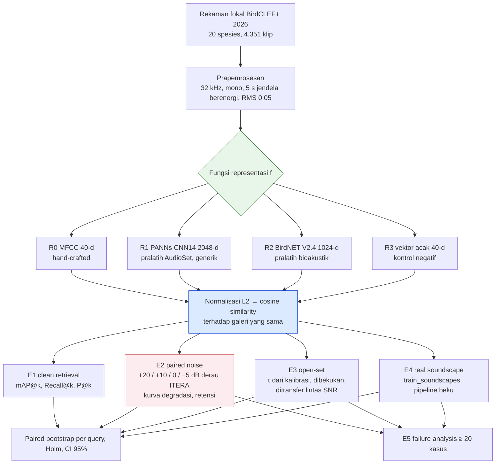
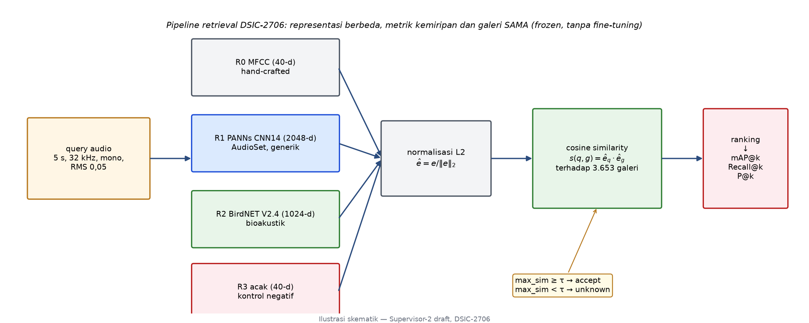
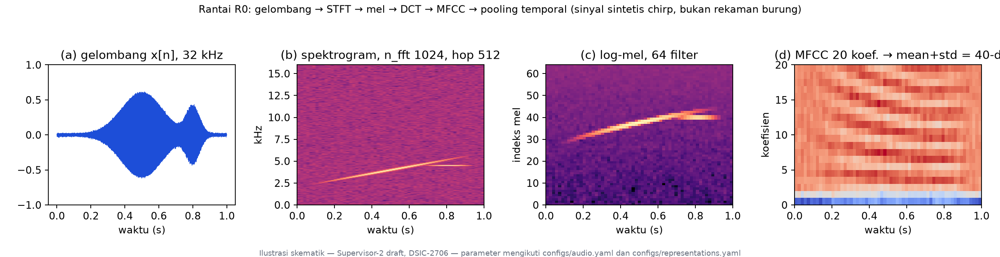
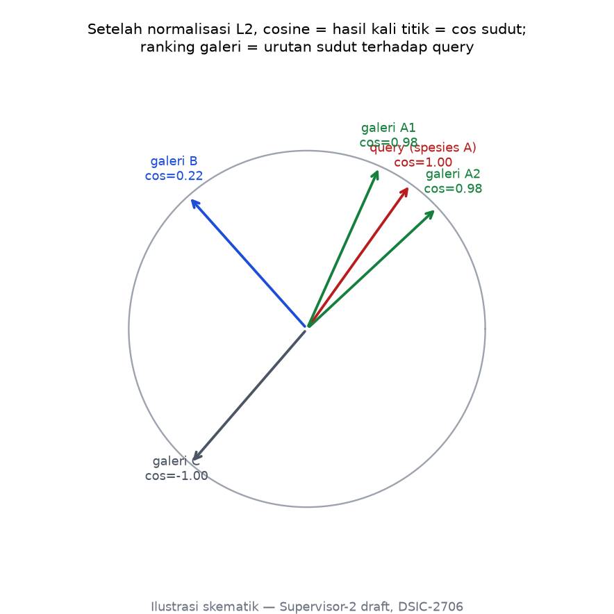
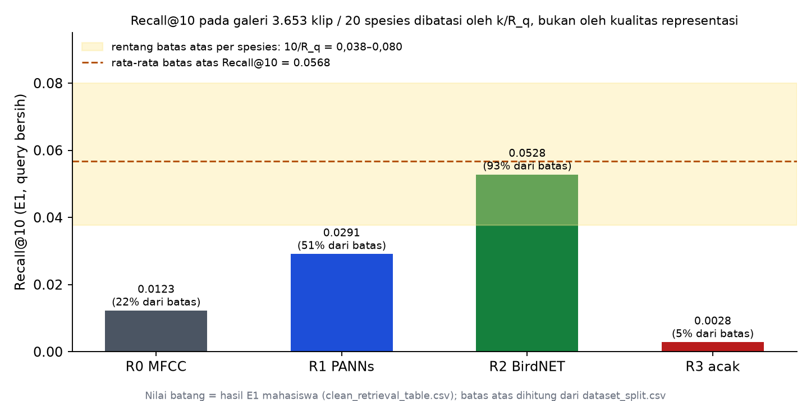
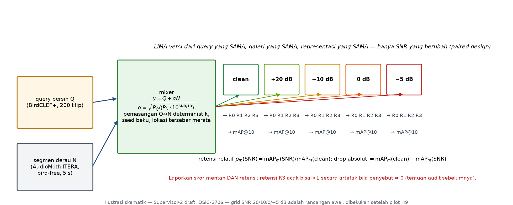
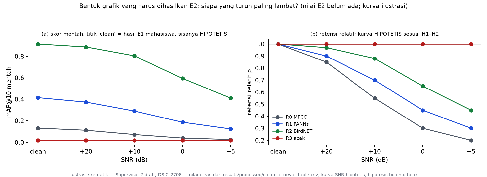
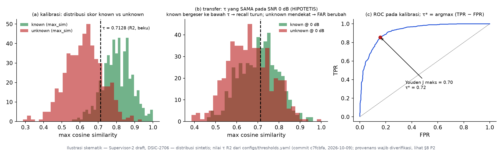
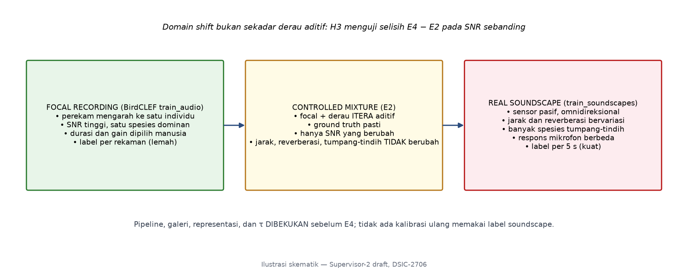
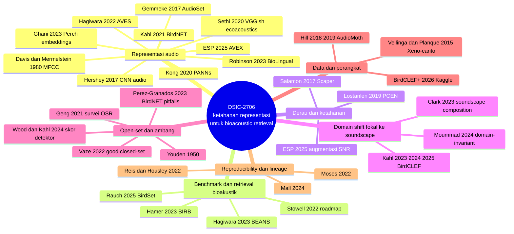

# Draft Teori Dasar, Formula Matematika, Ilustrasi, dan Tinjauan Pustaka — DSIC-2706

> **ARSIP HISTORIS — bukan scope/data aktif.** Draf ini masih menyebut BirdCLEF+ dan split lama. Penelitian aktif memakai 20 spesies Indonesia dari Xeno-Canto dan campuran aditif derau ITERA; lihat [status bahan dan rujukan terbaru](README.md). Isi historis di bawah dipertahankan, bukan diverifikasi ulang dalam sinkronisasi 1 November 2026.

> **SUPERVISOR PROPOSED DRAFT — BUKAN BUKTI MAHASISWA.**
> Dokumen ini disusun oleh Supervisor 1 sebagai **bahan** penulisan bab Teori Dasar dan Related Work untuk skripsi dan artikel DSIC-2706 (Fabio Banyu Cyto). Mahasiswa tetap harus menulis ulang, memahami, dan mempertanggungjawabkan setiap kalimat dan sitasi. Dokumen ini tidak boleh disalin langsung ke naskah tanpa pemeriksaan sumber primer.

| Item | Keterangan |
|---|---|
| Topik | *Noise and Domain-Shift Robustness of Frozen Audio Representations for Bioacoustic Similarity Retrieval: A Controlled Evaluation on BirdCLEF+ 2026 with Field-Recorded Tropical Noise* |
| Rezim data aktif | BirdCLEF+ 2026, 20 spesies, 4.351 klip; split *strict recordist-disjoint* (gallery 3.653 / query 200 / calibration 498); bank derau AudioMoth ITERA 1.799 berkas (DEC-09 s.d. DEC-12) |
| Sumber internal | `DSIC-2706/README.md`, `configs/*.yaml`, `src/mfcc.py`, `src/embeddings.py`, `src/mix_noise.py`, `src/calibrate_threshold.py`, `src/bootstrap_inference.py`, `docs/research/decision-log.md`, `supervision/01-dsic-2706/konsep-dan-teori-notebooks.md`, `progress.md` |
| Sumber buku (lokal) | `book/Deep-learning/`: Koenigstein (Transformers Beyond NLP, Bab 6 audio), Tunstall et al. (NLP with Transformers, embedding lookup dan FAISS), Mall (Deep Learning at Scale, transfer learning dan reproducibility). `book/Data-Engineering/`: Kleppmann & Riccomini (DDIA ed. 2, vector embeddings), Reis & Housley (lineage), Moses et al. (Data Quality Fundamentals). Dari 75 buku yang dipindai, hanya enam yang memuat materi relevan; tidak satu pun membahas bioakustik, MFCC, atau SNR secara langsung |
| Pustaka eksternal | 38 publikasi; metadata diverifikasi daring pada 2026-10-11 (§9 dan Lampiran A) |
| Jendela tinjauan | 2021–2026, ditambah karya seminal yang ditandai eksplisit |
| Gambar | `figures/fig01`–`fig08` (PNG) dan bagan Mermaid inline |
| Status | DRAFT v0.2 (2026-10-11) — direvisi agar tidak menyesatkan: §2.5 memakai batas atas recall yang dihitung dari manifes, keterangan Gambar 5 diluruskan, dan §8 memuat rekomendasi perbaikan konkret; keputusan Supervisor 1 tetap pada §7 |

Catatan rendering: bagan Mermaid tampil di GitHub dan VS Code dengan ekstensi *Markdown Preview Mermaid Support*. PNG tampil di semua pembaca Markdown.

---

## Daftar Isi

1. [Peta Konsep Penelitian](#1-peta-konsep-penelitian)
2. [Teori Dasar](#2-teori-dasar)
   - 2.1 Sinyal audio digital dan prapemrosesan
   - 2.2 Representasi hand-crafted: STFT, skala mel, MFCC
   - 2.3 Representasi pralatih: transfer learning sebagai feature extractor
   - 2.4 Ruang embedding, normalisasi L2, dan cosine similarity
   - 2.5 Similarity retrieval dan metriknya
   - 2.6 Ketahanan terhadap derau: pencampuran SNR terkontrol dan desain berpasangan
   - 2.7 Open-set recognition dan kalibrasi ambang
   - 2.8 Domain shift: focal recording versus soundscape
   - 2.9 Kebocoran, lineage, dan reproducibility
   - 2.10 Landasan statistik
3. [Tinjauan Pustaka 2021–2026](#3-tinjauan-pustaka-20212026)
4. [Karya Terdekat dan Posisi DSIC-2706](#4-karya-terdekat-dan-posisi-dsic-2706)
5. [Sintesis Research Gap](#5-sintesis-research-gap)
6. [Kerangka Formula Operasional Lengkap](#6-kerangka-formula-operasional-lengkap)
7. [Keputusan yang Memerlukan Supervisor 1](#7-keputusan-yang-memerlukan-supervisor-1)
8. [Rekomendasi Perbaikan — Supervisor Proposed Solutions](#8-rekomendasi-perbaikan--supervisor-proposed-solutions)
9. [Daftar Pustaka](#9-daftar-pustaka)
- Lampiran A: Log pencarian dan status verifikasi
- Lampiran B: Notasi

---

## 1. Peta Konsep Penelitian

Penelitian ini bukan membangun classifier spesies, melainkan menguji **fungsi representasi** $f$ mana yang paling mempertahankan kualitas *similarity retrieval* ketika query dirusak derau lapangan dan ketika domain berpindah dari rekaman fokal ke soundscape. Semua eksperimen (E0–E5) adalah tahapan dari satu kalimat itu.





*Gambar 2. Representasi berbeda, tetapi metrik kemiripan, galeri, dan prapemrosesan sama, sehingga yang dibandingkan adalah kualitas representasi intrinsik.*

---

## 2. Teori Dasar

### 2.1 Sinyal audio digital dan prapemrosesan

Suara adalah perubahan tekanan udara yang kontinu; audio digital menyampelnya pada interval diskret menjadi barisan amplitudo $x[n] = x(nT)$, $n = 0, \dots, N-1$, dengan $T = 1/f_s$ dan $f_s$ laju sampel (Koenigstein, Bab 6 [B1]). Menurut teorema Nyquist, laju sampel $f_s$ hanya merepresentasikan frekuensi sampai $f_s/2$; pada 32 kHz batasnya 16 kHz, cukup untuk hampir seluruh vokalisasi burung yang umumnya berada di 1–8 kHz [konsep-dan-teori-notebooks §2.1]. Rekaman BirdCLEF+ memiliki laju sampel asli yang beragam (22,05–48 kHz pada rezim lama), sehingga penyeragaman ke 32 kHz wajib agar jarak antar-vektor tidak mencerminkan perbedaan laju sampel.

Prapemrosesan DSIC-2706 (`configs/audio.yaml`, `src/preprocess.py`) terdiri atas tiga langkah deterministik:

1. **Konversi mono dan resampling** ke $f_s = 32\,000$ Hz.
2. **Pemotongan 5 detik pada jendela paling berenergi**: jendela $w$ sepanjang $L = 160\,000$ sampel digeser dengan *hop* $L/4$, dan dipilih jendela dengan RMS tertinggi,
   $$
   \mathrm{RMS}(w) = \sqrt{\tfrac{1}{L}\textstyle\sum_{n} w[n]^2}, \qquad w^{\ast} = \arg\max_{w} \mathrm{RMS}(w).
   $$
   Heuristik ini mengasumsikan bagian paling berenergi memuat vokalisasi; batasnya, gangguan keras non-burung dapat terpilih (catatan audit n-02).
3. **Normalisasi RMS** ke target $r_0 = 0{,}05$, lalu pemotongan ke $[-1, 1]$:
   $$
   y[n] = \mathrm{clip}\!\left(x[n]\cdot \frac{r_0}{\mathrm{RMS}(x)},\, -1,\, 1\right).
   $$
   Normalisasi ini memaksa perbandingan berfokus pada bentuk spektral, bukan kerasnya rekaman (rentang RMS asli melebihi 100 kali). Pemotongan membuat RMS akhir sedikit meleset pada klip berpuncak tinggi (temuan audit n-02); konsekuensi ini perlu dicatat karena normalisasi RMS juga menetapkan daya sinyal $P_Q = r_0^2 = 0{,}0025$ yang menjadi acuan pencampuran SNR (§2.6).

### 2.2 Representasi hand-crafted: STFT, skala mel, MFCC

Transformasi Fourier biasa membuang informasi waktu, padahal kicau burung bermakna karena polanya berubah menurut waktu. *Short-Time Fourier Transform* (STFT) memotong sinyal menjadi bingkai yang saling bertumpang tindih dan menerapkan DFT pada tiap bingkai (Koenigstein, Bab 6 [B1]):

$$
S(m, \omega) = \sum_{n=-\infty}^{\infty} x[n]\, w[n - m]\, e^{-j\omega n},
$$

dengan $w$ jendela Hann yang meredam tepi bingkai untuk mengurangi *spectral leakage*, dan $m$ indeks posisi bingkai. DSIC-2706 memakai $n_{\text{fft}} = 1024$ (sekitar 32 ms) dan *hop* 512 (tumpang tindih 50%). Terdapat pertukaran mendasar: bingkai panjang memberi resolusi frekuensi baik tetapi resolusi waktu buruk, dan sebaliknya.

**Skala mel** memampatkan sumbu frekuensi agar mendekati sensitivitas pendengaran manusia (Koenigstein [B1]):

$$
m(f) = 2595 \cdot \log_{10}\!\left(1 + \frac{f}{700}\right).
$$

Spektrogram daya $|S|^2$ dilewatkan ke bank filter segitiga pada skala mel, $M_k = \sum_{\omega} H_k(\omega)\,|S(m,\omega)|^2$, $k = 1,\dots,64$ (rentang 150–15.000 Hz menurut `configs/representations.yaml`), lalu dilogaritmakan. **MFCC** (Davis & Mermelstein, 1980 [1]) adalah transformasi kosinus diskret (DCT) dari log-energi mel, yang mendekorelasi koefisien dan memampatkan informasi *envelope* spektral:

$$
c_i(m) = \sum_{k=1}^{K} \log\big(M_k(m)\big)\cos\!\left[\frac{\pi i}{K}\left(k + \tfrac{1}{2}\right)\right], \qquad i = 0, \dots, 19 .
$$

Representasi R0 mengambil 20 koefisien per bingkai, lalu melakukan *temporal pooling* rata-rata dan simpangan baku atas semua bingkai sehingga diperoleh vektor 40 dimensi:

$$
\mathbf{e}_{R0} = \big[\, \mu(c_0),\dots,\mu(c_{19}),\; \sigma(c_0),\dots,\sigma(c_{19}) \,\big] \in \mathbb{R}^{40}.
$$

Implementasi memakai `librosa.feature.mfcc` (McFee et al., 2015 [2]). Catatan konsistensi: README menyebut "40 koefisien + delta + delta-delta", sedangkan `src/mfcc.py` dan `configs/representations.yaml` mengimplementasikan 20 koefisien dengan pooling mean+std = 40-d; naskah harus mengikuti kode.



*Gambar 1. Rantai R0 pada sinyal chirp sintetis (bukan rekaman burung): gelombang, spektrogram, log-mel, MFCC. Parameter mengikuti konfigurasi mahasiswa.*

### 2.3 Representasi pralatih: transfer learning sebagai feature extractor

Mall (2024) menjelaskan transfer learning sebagai memulai dari bobot model yang sudah dilatih pada domain sumber, bukan dari inisialisasi acak, dengan tiga mode: *retraining*, *fine-tuning*, dan *pretraining*; ia juga memperingatkan "the negative effect that may occur if the origin domain of the source model ... does not overlap with the target domain" [B4]. DSIC-2706 memakai mode yang lebih ketat lagi: **frozen feature extractor**, yaitu bobot tidak diubah sama sekali dan keluaran lapisan penultimate dipakai sebagai embedding. Pilihan ini membuat perbandingan antar-representasi bersih dari efek pelatihan ulang, tetapi juga berarti kinerja sepenuhnya bergantung pada kesesuaian domain pralatih dengan domain target. Inilah alasan sub-RQ 3 dan H2: apakah pralatih bioakustik (R2) memberi keunggulan atas pralatih audio umum (R1).

**R1 — PANNs CNN14.** Kong et al. (2020) melatih keluarga CNN pada AudioSet (Gemmeke et al., 2017 [3]; 2,08 juta klip YouTube 10 detik, 527 kelas), dengan CNN14 mencapai mAP 0,431 pada *audio tagging* dan "a good balance between the tagging performance and the computation complexity" [5]. Checkpoint `Cnn14_mAP=0.431.pth` dipakai pada 32 kHz; embedding 2048-d diambil dari lapisan sebelum klasifikasi. Garis ini bermula dari Hershey et al. (2017) yang menerapkan arsitektur CNN citra (VGG, Inception, ResNet) pada log-mel audio berskala besar [4]; embedding VGGish turunannya telah dipakai Sethi et al. (2020) sebagai *universal acoustic feature set* untuk memetakan soundscape lintas ekosistem ke satu ruang akustik bersama [18].

**R2 — BirdNET V2.4.** Kahl et al. (2021) mengembangkan BirdNET sebagai CNN untuk mengenali lebih dari 6.000 spesies burung dari segmen 3 detik [6]. DSIC-2706 memakai *backbone* V2.4 (1024-d) sebagai embedding, bukan keluaran softmax spesies, dengan audio di-resample ke 48 kHz, dipotong menjadi jendela 3 detik dengan *hop* 1 detik, lalu embedding jendela dirata-ratakan (`src/embeddings.py`). Ghani et al. (2023) menunjukkan bahwa embedding dari classifier burung berskala global (Perch dan BirdNET) memberi transfer learning yang unggul untuk tugas bioakustik yang tidak dilatih sebelumnya, termasuk kelelawar, mamalia laut, dan amfibi, bahkan dengan sedikit contoh [7].

**R3 — kontrol acak.** Vektor acak seragam 40-d dengan seed 42 memberi batas bawah empiris; H5 mensyaratkan R0–R2 jauh di atas R3, dan E0 telah memverifikasinya.

### 2.4 Ruang embedding, normalisasi L2, dan cosine similarity

Kleppmann & Riccomini (2025) menjelaskan bahwa model embedding memetakan dokumen ke titik dalam ruang multidimensi sehingga "embeddings that are near each other ... when the embedding's input documents are semantically similar", dan bahwa mesin pencari memakai fungsi jarak seperti *cosine similarity* atau jarak Euclid; mereka mencatat bahwa model embedding juga telah dibuat untuk audio [B3]. Tunstall et al. (2022) mendemonstrasikan *nearest neighbor embedding lookup* dengan FAISS (Johnson et al., 2019 [33]) sebagai mesin pencari embedding [B2].

Untuk embedding $\mathbf{e} \in \mathbb{R}^{d}$, normalisasi L2 memproyeksikannya ke bola satuan, $\hat{\mathbf{e}} = \mathbf{e} / \lVert \mathbf{e} \rVert_2$, sehingga cosine similarity menyederhana menjadi hasil kali titik:

$$
s(q, g) = \cos\theta_{qg} = \frac{\mathbf{e}_q \cdot \mathbf{e}_g}{\lVert \mathbf{e}_q \rVert_2 \lVert \mathbf{e}_g \rVert_2} = \hat{\mathbf{e}}_q \cdot \hat{\mathbf{e}}_g \in [-1, 1].
$$

Pada bola satuan, jarak Euclid dan cosine ekuivalen secara monoton, $\lVert \hat{\mathbf{e}}_q - \hat{\mathbf{e}}_g \rVert_2^2 = 2 - 2\, s(q,g)$, sehingga ranking identik. Wang & Isola (2020) memformalkan dua sifat ruang yang baik pada hiperbola satuan: *alignment* (pasangan positif berdekatan) dan *uniformity* (fitur tersebar merata) [32]; H1–H2 pada dasarnya menguji seberapa baik *alignment* intra-spesies bertahan di bawah derau. Dengan galeri 3.653 klip, pencarian linear (*flat index*) cukup; FAISS hanya diperlukan bila galeri jauh lebih besar [B3].



*Gambar 7. Setelah normalisasi L2, ranking galeri adalah urutan sudut terhadap query.*

### 2.5 Similarity retrieval dan metriknya

Untuk query $q$ berspesies $y_q$, galeri diurutkan menurun menurut $s(q, g)$. Misalkan $\mathrm{rel}_i \in \{0,1\}$ menandai apakah item peringkat ke-$i$ berspesies sama, $R_q$ jumlah item relevan dalam galeri, dan $k$ kedalaman evaluasi (Manning et al., 2008 [34]):

$$
P@k = \frac{1}{k}\sum_{i=1}^{k} \mathrm{rel}_i, \qquad
R@k = \frac{1}{R_q}\sum_{i=1}^{k} \mathrm{rel}_i, \qquad
AP@k = \frac{1}{\min(R_q, k)} \sum_{i=1}^{k} P@i \cdot \mathrm{rel}_i,
$$

$$
\mathrm{mAP}@k = \frac{1}{|\mathcal{Q}|}\sum_{q \in \mathcal{Q}} AP@k(q), \qquad
\mathrm{MRR} = \frac{1}{|\mathcal{Q}|}\sum_{q} \frac{1}{\mathrm{rank}_q^{\text{first}}}.
$$

Tunstall et al. menyebut mAP sebagai pelengkap recall yang "rewards retrievers that can place the correct answers higher up in the document ranking" [B2]; Tandon et al. mencatat MAP "focuses more narrowly on the quality of the top recommendations" dibanding AUC [B7].

**Catatan penting tentang Recall@10 pada desain ini.** Karena $R@k$ membagi jumlah hit dengan seluruh item relevan di galeri (`src/retrieve.py`: `rec_k = hits / total_relevant`), nilainya dibatasi oleh

$$
R@k \;\le\; \min\!\left(1,\; \frac{k}{R_q}\right).
$$

Dari `data/manifests/dataset_split.csv`, jumlah klip galeri per spesies adalah 125–266 (median 184), sehingga batas atas $R@10$ per spesies hanya 0,038–0,080 dengan rata-rata 0,0568. Nilai E1 mahasiswa harus dibaca terhadap batas ini: R2 = 0,0528 (93% dari batas), R1 = 0,0291 (51%), R0 = 0,0123 (22%), R3 = 0,0028 (5%). Dengan demikian kolom Recall@10 pada tabel E1 README **tidak boleh** ditafsirkan sebagai "recall rendah" dan selisih antar-representasi pada metrik ini terkompresi oleh kepadatan galeri, bukan oleh kualitas representasi. Dua bentuk yang informatif adalah **recall ternormalisasi** dan **R-precision**:

$$
\tilde{R}@k = \frac{R@k}{\min(1, k/R_q)} \in [0, 1], \qquad
\text{R-prec} = P@R_q = \frac{1}{R_q}\sum_{i=1}^{R_q} \mathrm{rel}_i .
$$

Keduanya mencapai 1 hanya bila semua item relevan menempati peringkat teratas. Rekomendasi perbaikan konkret ada di §8 (P1); keputusan pemilihannya di §7 (D1).



*Gambar 8. Recall@10 hasil E1 mahasiswa dibandingkan batas atas yang dihitung dari manifes galeri. Yang membatasi adalah $k/R_q$, bukan representasi.*

### 2.6 Ketahanan terhadap derau: pencampuran SNR terkontrol dan desain berpasangan

*Signal-to-noise ratio* didefinisikan dari daya sinyal dan daya derau, $P_x = \tfrac{1}{N}\sum_n x[n]^2$:

$$
\mathrm{SNR}_{\text{dB}} = 10 \log_{10}\frac{P_Q}{P_N}.
$$

Untuk mencapai SNR target, segmen derau $N$ diskalakan dengan faktor $\alpha$ sebelum dijumlahkan (persis seperti `src/mix_noise.py`):

$$
y = Q + \alpha N, \qquad \alpha = \sqrt{\frac{P_Q}{P_N \cdot 10^{\mathrm{SNR}_{\text{dB}}/10}}}.
$$

Karena $Q$ telah dinormalisasi RMS, $P_Q = 0{,}0025$ untuk semua query sehingga skala derau hanya bergantung pada $P_N$ dan SNR; uji unit `tests/test_snr_mixing.py` memverifikasi SNR terukur dalam toleransi. Pendekatan sintesis soundscape dengan SNR terkendali ini sejalan dengan Scaper (Salamon et al., 2017) yang menspesifikasikan SNR per *event* dalam soundscape sintetis [28]; dan pada representasi pralatih, Earth Species Project (2025) menambahkan derau pada SNR acak di rentang −10 hingga 20 dB sebagai augmentasi untuk meningkatkan ketahanan representasi [16].

**Desain berpasangan.** Lima versi ($Q_{\text{clean}}, Q_{+20}, Q_{+10}, Q_{0}, Q_{-5}$) berasal dari query yang sama, diuji pada galeri yang sama, dengan representasi yang sama; hanya SNR yang berubah. Untuk representasi $m$, ukuran ketahanan adalah

$$
\Delta_m(\mathrm{SNR}) = \mathrm{mAP}_m(\text{clean}) - \mathrm{mAP}_m(\mathrm{SNR}), \qquad
\rho_m(\mathrm{SNR}) = \frac{\mathrm{mAP}_m(\mathrm{SNR})}{\mathrm{mAP}_m(\text{clean})}.
$$

Skor mentah dan retensi harus dilaporkan berdampingan: representasi berskor bersih rendah dapat tampak "stabil" secara semu, dan audit sebelumnya menemukan $\rho_{R3} = 1{,}409$ pada 10 dB sebagai artefak aritmetika ketika penyebut mendekati nol. Pemasangan query ke segmen derau harus deterministik (seed beku, disimpan sebagai manifes) dan tipe lokasi derau tersebar merata pada tiap SNR agar efek SNR tidak bercampur efek jenis derau (README H8). Lostanlen et al. (2019) menunjukkan bahwa derau latar pada jaringan sensor bioakustik bersifat heterogen menurut waktu dan lokasi, dan bahwa normalisasi adaptif (PCEN) mengurangi *overfitting* temporal [17]; ini memperkuat alasan menyebarkan lokasi derau secara merata.



*Gambar 3. Mixer deterministik menghasilkan lima versi dari query yang sama.*



*Gambar 4. Bentuk grafik yang harus dihasilkan E2. Titik "clean" adalah hasil E1 mahasiswa; kurva SNR hipotetis dan hipotesis boleh ditolak.*

### 2.7 Open-set recognition dan kalibrasi ambang

Soundscape nyata tidak selalu memuat spesies galeri. *Open-set recognition* (OSR) menuntut sistem menolak input yang tidak termasuk kelas yang dikenal (Geng et al., 2021 [30]). Vaze et al. (2022) menunjukkan bahwa kemampuan menolak unknown berkorelasi kuat dengan akurasi closed-set dan bahwa skor sederhana (*maximum logit*) menjadi baseline yang kompetitif [29]. Analogi pada retrieval: skor open-set adalah kemiripan maksimum terhadap galeri,

$$
s_{\max}(q) = \max_{g \in \mathcal{G}} s(q, g), \qquad
\text{terima} \iff s_{\max}(q) \ge \tau .
$$

Dengan label $z_q = 1$ untuk known dan $0$ untuk unknown, pada ambang $\tau$:

$$
\mathrm{TPR}(\tau) = P(s_{\max} \ge \tau \mid z = 1), \qquad
\mathrm{FPR}(\tau) = \mathrm{FAR}(\tau) = P(s_{\max} \ge \tau \mid z = 0).
$$

Ambang dipilih **hanya** dari calibration split dengan indeks Youden (Youden, 1950 [31]), sesuai DEC-04 dan `src/calibrate_threshold.py`:

$$
J(\tau) = \mathrm{TPR}(\tau) - \mathrm{FPR}(\tau), \qquad \tau^{\ast} = \arg\max_{\tau} J(\tau),
$$

lalu dibekukan. AUROC merangkum seluruh kurva (Tandon et al. menafsirkannya sebagai peluang bahwa item positif acak berperingkat di atas item negatif acak [B7]); AUPRC lebih sensitif pada ketidakseimbangan. Yang diuji H4 bukan $\tau^{\ast}$ terbaik, melainkan **transfer** $\tau^{\ast}$ beku ke kondisi lain: $\mathrm{FPR}(\tau^{\ast}, \mathrm{SNR})$ dan $\mathrm{recall}(\tau^{\ast}, \mathrm{SNR})$ untuk tiga jenis unknown (burung non-target, non-burung, derau murni). Kedua sisi dapat bergerak berlawanan: audit sebelumnya menemukan R2 paling stabil pada FPR tetapi paling dalam penurunan recall-nya. Pérez-Granados (2023) dan Wood & Kahl (2024) menekankan bahwa skor detektor seperti BirdNET bergantung kuat pada kondisi perekaman dan bahwa ambang harus diperlakukan hati-hati, bukan sebagai probabilitas yang dapat dipindahkan begitu saja [19][20].



*Gambar 5. Kalibrasi τ dengan Youden J pada distribusi skor sintetis dan ilustrasi mengapa τ beku dapat gagal ketika distribusi bergeser pada SNR rendah. Nilai τ = 0,7128 diambil dari `configs/thresholds.yaml` (commit `c7fcbfa`, 2026-10-09, setelah pivot DEC-09); apakah nilai itu benar-benar dikalibrasi pada 498 klip kalibrasi BirdCLEF+ 2026 dan 498 unknown kalibrasi harus diverifikasi dari log kalibrasi (§8 P2).*

### 2.8 Domain shift: focal recording versus soundscape

Rekaman fokal (Xeno-canto, BirdCLEF `train_audio`) direkam oleh manusia yang mengarahkan perekam ke satu individu; soundscape direkam sensor pasif omnidireksional dengan jarak, reverberasi, respons mikrofon, dan tumpang-tindih spesies yang bervariasi. Secara formal ini *covariate shift*: $P_{\text{focal}}(x) \ne P_{\text{soundscape}}(x)$ walaupun hubungan $P(y \mid x)$ dianggap sama. BirdCLEF mengevaluasi dengan soundscape independen sejak 2019 dan menyebutnya sebagai domain shift (Kahl et al., 2023; 2024; 2025 [21][22][23]); BirdSet (Rauch et al., 2025) membakukannya sebagai *covariate shift* antara pelatihan fokal dan evaluasi soundscape beranotasi [13]; BIRB (Hamer et al., 2023) menjadikannya benchmark **retrieval** [8]; Moummad et al. (2024) mengusahakan representasi *domain-invariant* dengan *supervised contrastive learning* [14]; Clark et al. (2023) menemukan bahwa pralatih dengan data Xeno-canto menaikkan presisi tetapi sedikit menurunkan recall pada data soundscape [15].

Kontribusi H3 DSIC-2706 terletak pada **pemisahan** dua sumber penurunan: derau aditif terkontrol (E2) dan domain shift nyata (E4). Selisih

$$
\mathrm{gap}_m = \mathrm{metric}_m^{E4} - \mathrm{metric}_m^{E2}\big|_{\mathrm{SNR\ sebanding}}
$$

mengukur bagian penurunan yang **tidak** dapat dijelaskan oleh derau aditif. Prasyaratnya: pipeline, galeri, representasi, dan $\tau$ dibekukan sebelum E4, dan `test_soundscapes` tidak dipakai (README H18).



*Gambar 6. Domain shift nyata mencakup lebih dari derau aditif; H3 menguji selisihnya.*

### 2.9 Kebocoran, lineage, dan reproducibility

**Kebocoran perekam.** Rekaman dari perekam yang sama berbagi sidik jari perangkat (mikrofon, gain, lokasi), sehingga kesamaan yang terdeteksi bisa berasal dari perangkat, bukan spesies. Partisi *strict global recordist-disjoint* (DEC-05) mensyaratkan $\mathcal{R}_{\text{gallery}} \cap \mathcal{R}_{\text{query}} \cap \mathcal{R}_{\text{calibration}} = \emptyset$ pada himpunan perekam, ditambah nol tumpang tindih ID rekaman dan path berkas, dan diverifikasi otomatis oleh `tests/test_split_leakage.py`. BIRB memakai prinsip serupa dengan memisahkan perekam fokal dari soundscape [8].

**Lineage sebagai syarat klaim.** Reis & Housley (2022) mendefinisikan *data-lineage metadata* sebagai jejak audit yang "tracks the origin and changes to data, and its dependencies, over time" [B5]; Moses et al. (2022) menempatkan lineage sebagai pilar paling holistik dari lima pilar *data observability* (freshness, distribution, volume, schema, lineage) karena ia "contextualizes incidents" dengan menunjukkan sumber hulu dan dampak hilir [B6]. Pada DSIC-2706, lineage diwujudkan sebagai manifes dengan SHA-256 per berkas (4.351 klip BirdCLEF dan 1.799 berkas derau), `species_freeze.csv`, `species_excluded.csv`, dan rantai RQ → eksperimen → raw → processed → tabel/gambar → klaim (README §14). Mall (2024) mengingatkan bahwa komputasi GPU bersifat nondeterministik (auto-tuning konvolusi, cuBLAS) sehingga "benchmark results should not only be repeated but also processed with an allowed variance margin" [B4]; untuk pipeline ini, determinisme ekstraksi embedding harus diverifikasi (E0 memeriksa norma dan NaN; verifikasi bitwise dua run belum tercatat).

**Kontaminasi pralatih.** BirdNET dilatih pada data yang mencakup Xeno-canto dan BirdCLEF, sementara `train_audio` BirdCLEF+ 2026 bersumber dari Xeno-canto dan iNaturalist. Klip galeri atau query mungkin pernah dilihat R2 saat pralatih, yang dapat menaikkan skor R2 secara tidak adil terhadap R1 (AudioSet YouTube) dan R0. Ini bukan kebocoran yang dapat dihapus oleh split, karena bobot model tidak dapat "dibersihkan"; ia harus dinyatakan sebagai ancaman validitas dan, bila mungkin, dimitigasi (§7, D3).

### 2.10 Landasan statistik

**Unit resampling** adalah query (atau rekaman), bukan salinan berderau; lima versi dari query yang sama berbagi konten sehingga bukan sampel independen. **Paired bootstrap** (Efron, 1979 [35]) atas selisih per query, misalnya $d_q = AP_{R2}(q) - AP_{R1}(q)$ pada SNR tertentu:

1. untuk $b = 1,\dots,B$ ($B = 1000$ menurut `configs/experiments.yaml`): tarik 200 indeks query dengan pengembalian, hitung $\bar{d}_b$;
2. CI 95% = persentil 2,5 dan 97,5 dari $\{\bar{d}_b\}$;
3. selisih "terdukung" bila CI tidak memuat nol.

Perbandingan antar-representasi dan antar-SNR membentuk keluarga uji ganda yang dikoreksi Holm (1979 [36]). *Smallest effect size of interest* ditetapkan sebelum melihat hasil (Lakens et al., 2018 [38]); hasil nol dilaporkan apa adanya. Kata "signifikan" hanya dipakai bila didukung CI berpasangan (README H25). Dengan $n = 200$ query, daya untuk mendeteksi selisih AP berukuran sedang memadai; daya untuk interaksi representasi × SNR × jenis derau lebih kecil dan harus diberi catatan.

---

## 3. Tinjauan Pustaka 2021–2026



### 3.1 Representasi audio: dari hand-crafted ke pralatih bioakustik

MFCC (Davis & Mermelstein, 1980) lahir dari pengenalan kata dan tetap menjadi baseline akustik klasik [1]. Pergeseran ke representasi yang dipelajari dimulai saat Hershey et al. (2017) menunjukkan arsitektur CNN citra bekerja pada log-mel audio berskala besar [4], didukung AudioSet (Gemmeke et al., 2017) [3]. PANNs (Kong et al., 2020) merilis CNN pralatih AudioSet yang dapat ditransfer ke enam tugas audio [5]; Sethi et al. (2020) memakai embedding VGGish sebagai fitur universal untuk soundscape ekologis [18]. Pada domain burung, BirdNET (Kahl et al., 2021) menjadi classifier global yang paling banyak dipakai [6]; Ghani et al. (2023) membuktikan embedding-nya (bersama Perch) unggul untuk transfer ke taksa lain [7]. Garis *self-supervised* dan multimodal menyusul: AVES (Hagiwara, 2022) berbasis HuBERT [11], BioLingual (Robinson et al., 2023) berbasis pralatih kontrastif bahasa-audio [12], dan studi besar Earth Species Project (2025), yang pada ICLR 2026 bernama AVEX, menemukan bahwa resep terbaik adalah pralatih *self-supervised* diikuti *supervised post-training* pada campuran bioakustik dan audio umum, dengan keragaman data sebagai faktor kunci [16]. Stowell (2022) memberi peta jalan bidang ini dan menekankan bahwa karakteristik data bioakustik berbeda dari speech dan musik [9].

**Posisi DSIC-2706:** tiga representasi yang dibandingkan (R0, R1, R2) mewakili tiga generasi di atas, dibandingkan pada protokol retrieval yang identik, bukan pada akurasi klasifikasi.

### 3.2 Benchmark dan retrieval bioakustik

BEANS (Hagiwara et al., 2023) membakukan klasifikasi dan deteksi pada 12 dataset lintas taksa [10]. BIRB (Hamer et al., 2023) mengubah soal menjadi **retrieval**: mengambil vokalisasi burung dari rekaman pasif berdasarkan rekaman fokal, dengan baseline *representation learning + nearest-centroid search* [8]. BirdSet (Rauch et al., 2025) menyediakan 6.800 jam pelatihan fokal dan delapan dataset soundscape beranotasi kuat untuk mengukur *covariate shift* [13]. Tidak satu pun benchmark ini mengukur **kurva degradasi terhadap SNR** dengan derau lapangan nyata pada query yang sama, dan tidak satu pun membandingkan hand-crafted, generik, dan bioakustik di bawah protokol cosine yang sama.

### 3.3 Derau dan ketahanan

Scaper (Salamon et al., 2017) memformalkan sintesis soundscape dengan SNR terkendali per event [28]; Lostanlen et al. (2019) menunjukkan derau latar jaringan sensor bervariasi menurut waktu dan lokasi, dan PCEN serta *context adaptation* mengurangi overfitting spasial-temporal [17]. Pada level representasi, Earth Species Project (2025) memakai augmentasi derau pada SNR acak dan mengevaluasi dengan metrik klastering dan retrieval [16]. Pencarian pada 2026-10-11 **tidak** menemukan publikasi yang mengevaluasi retrieval bioakustik sebagai fungsi SNR dengan derau lapangan tropis; temuan terdekat adalah studi deteksi *Athene noctua* dengan augmentasi SNR terkontrol (arXiv:2507.16235, 2025; metadata penulis belum diverifikasi) dan studi *speaker retrieval* pada SNR 0–10 dB di domain ucapan.

### 3.4 Domain shift fokal ke soundscape

Overview BirdCLEF 2023–2025 (Kahl et al.) secara konsisten melaporkan tantangan generalisasi *out-of-distribution* dari data fokal ke soundscape lapangan [21][22][23]; BirdCLEF+ 2026 berfokus pada Pantanal, Brasil, dengan evaluasi makro ROC-AUC pada jendela 5 detik [24]. Clark et al. (2023) mengukur efek komposisi soundscape pada klasifikasi dan efek pralatih Xeno-canto [15]; Moummad et al. (2024) mengusulkan ProtoCLR untuk invariansi domain dengan evaluasi few-shot di atas BIRB [14]. Semua karya ini mengukur **klasifikasi atau few-shot** pada soundscape; DSIC-2706 mengukur **retrieval** dengan pipeline beku dan memisahkan efek derau aditif dari domain shift.

### 3.5 Open-set dan ambang

Geng et al. (2021) mensurvei OSR [30]; Vaze et al. (2022) menunjukkan bahwa classifier closed-set yang baik sudah memberi OSR yang kuat dengan skor logit maksimum [29]. Untuk bioakustik terapan, Pérez-Granados (2023) merangkum bahwa kinerja BirdNET sangat dipengaruhi kondisi perekaman [19], dan Wood & Kahl (2024) memberi pedoman penggunaan skor detektor, termasuk peringatan terhadap pemakaian ambang tanpa kalibrasi lokal [20]. DSIC-2706 menguji secara eksplisit **stabilitas ambang beku** lintas SNR dan domain, dengan tiga jenis unknown yang dilaporkan terpisah.

### 3.6 Data dan perangkat

Xeno-canto (Vellinga & Planqué, 2015) adalah sumber utama rekaman fokal BirdCLEF [25]. AudioMoth (Hill et al., 2018; 2019) adalah perekam akustik pasif berbiaya rendah dengan laju sampel hingga 384 kHz [26][27]; seluruh bank derau DSIC-2706 berasal dari satu jenis perangkat ini dengan satu konfigurasi (variabel kontrol, DEC-11 dan DEC-12), yang harus dinyatakan sebagai *sidik jari perangkat* dalam ancaman validitas.

### 3.7 Reproducibility dan lineage

Buku rekayasa data memberi kerangka yang jarang dikutip dalam artikel bioakustik tetapi langsung relevan: lineage metadata (Reis & Housley, 2022 [B5]), lima pilar observabilitas data (Moses et al., 2022 [B6]), dan nondeterminisme komputasi deep learning (Mall, 2024 [B4]). Disiplin manifes-hash-seed DSIC-2706 dapat diposisikan sebagai penerapan prinsip ini pada eksperimen bioakustik.

---

## 4. Karya Terdekat dan Posisi DSIC-2706

| Dimensi | BIRB (Hamer et al., 2023) [8] | Ghani et al. (2023) [7] | ESP/AVEX (2025) [16] | Moummad et al. (2024) [14] | DSIC-2706 |
|---|---|---|---|---|---|
| Tugas | retrieval fokal → pasif | transfer learning (probing) | benchmark encoder, 26 dataset | domain-invariant few-shot | similarity retrieval + open-set |
| Representasi | Perch dkk. | BirdNET, Perch, dll. | 19 model | ProtoCLR, SupCon | R0 MFCC, R1 PANNs, R2 BirdNET, R3 acak |
| Derau terkontrol | tidak | tidak | augmentasi saat latih | tidak | **kurva SNR berpasangan dengan derau lapangan nyata** |
| Sumber derau | — | — | sintetis/aug | — | AudioMoth ITERA, 5 lokasi, 2 metode trigger |
| Open-set / ambang | sebagian (nearest-centroid) | tidak | tidak | tidak | **τ beku, transfer lintas SNR, 3 jenis unknown** |
| Domain shift | ya (benchmark) | tidak | OOD evaluasi | ya | ya, dipisahkan dari derau aditif (H3) |
| Kontrol negatif | tidak | tidak | tidak | tidak | ya (R3) |
| Split perekam | ya | — | — | — | strict recordist-disjoint, diuji otomatis |

**Apa yang sudah dijawab literatur:** embedding bioakustik global mentransfer dengan baik (Ghani), retrieval fokal → pasif adalah masalah generalisasi yang sulit (BIRB, BirdSet), dan augmentasi derau membantu (ESP 2025).

**Ruang DSIC-2706:** (i) kurva degradasi **berpasangan** terhadap SNR dengan derau lapangan tropis nyata dari geografi berbeda; (ii) perbandingan tiga generasi representasi plus kontrol acak di bawah protokol cosine identik; (iii) uji transfer ambang open-set beku lintas SNR dan domain; (iv) pemisahan eksplisit derau aditif dari domain shift nyata.

**Risiko klaim:** novelty tidak boleh dinyatakan sebagai "pertama mengevaluasi embedding bioakustik" (sudah dilakukan [7][8][16]); klaim yang defensibel adalah *controlled, paired noise-and-domain-shift evaluation of frozen representations for retrieval*. Kontaminasi pralatih BirdNET dan ketidakcocokan geografis (spesies Pantanal, derau Sumatera) wajib dinyatakan.

---

## 5. Sintesis Research Gap

| # | Gap | Dasar bukti | Status |
|---|---|---|---|
| G1 | Belum ada kurva degradasi retrieval terhadap SNR dengan derau lapangan nyata pada query yang sama, untuk hand-crafted vs generik vs bioakustik | §3.2–3.3; pencarian extended tidak menemukan | *Externally verified literature gap* (38 publikasi; Google Scholar sistematis belum) |
| G2 | Transfer ambang open-set beku lintas SNR dan domain pada retrieval bioakustik belum diuji eksplisit | §3.5 | *Externally verified* |
| G3 | Pemisahan derau aditif dari domain shift nyata (E4 − E2) belum dilaporkan sebagai besaran | §3.4 | *Repository-supported*; perlu pencarian tambahan |
| G4 | Derau tropis Asia Tenggara sebagai stressor untuk representasi yang dilatih pada data global | §3.6 | *Repository-supported* |
| G5 | Efek kontaminasi pralatih pada perbandingan embedding frozen | §2.9 | terbuka; mitigasi memerlukan keputusan (§7 D3) |

Keterbatasan tinjauan: pencarian memakai mesin pencari web dan halaman arXiv/penerbit, bukan Google Scholar dengan *citation chaining* lengkap seperti pada skill `research-prior-art-search`. Sebelum submission, mahasiswa wajib memeriksa *Cited by* untuk [7], [8], [13], [16] dan query pada Lampiran A.

---

## 6. Kerangka Formula Operasional Lengkap

**(F1) Prapemrosesan.** $y = \mathrm{clip}(x \cdot r_0/\mathrm{RMS}(x), -1, 1)$ pada jendela 5 s berenergi tertinggi, $f_s = 32$ kHz, $r_0 = 0{,}05$.

**(F2) R0.** MFCC 20 koefisien ($n_{\text{fft}} = 1024$, hop 512, 64 mel, 150–15.000 Hz), pooling mean+std → 40-d.

**(F3) R1, R2.** Embedding penultimate frozen; R2 pada 48 kHz, jendela 3 s, hop 1 s, mean pooling → 1024-d.

**(F4) Kemiripan.** $\hat{\mathbf{e}} = \mathbf{e}/\lVert \mathbf{e} \rVert_2$; $s(q,g) = \hat{\mathbf{e}}_q \cdot \hat{\mathbf{e}}_g$.

**(F5) Metrik retrieval.** $P@k$, $R@k$, $AP@k$, mAP@k, MRR, Top-1 (§2.5); catatan ceiling $R@10 \le 10/R_q$.

**(F6) Mixer.** $y = Q + \alpha N$, $\alpha = \sqrt{P_Q/(P_N 10^{\mathrm{SNR}/10})}$; grid awal $\{20, 10, 0, -5\}$ dB dibekukan setelah pilot; pemasangan $Q \leftrightarrow N$ deterministik; lokasi tersebar merata.

**(F7) Ketahanan.** $\Delta_m$ dan $\rho_m$ per SNR; keduanya dilaporkan; selisih berpasangan per query $d_q$.

**(F8) Open-set.** $s_{\max}(q)$; $\tau^{\ast} = \arg\max_\tau [\mathrm{TPR}(\tau) - \mathrm{FPR}(\tau)]$ pada calibration split saja; evaluasi AUROC, AUPRC, F1@τ, FPR/FAR@τ, recall@τ per jenis unknown (a)/(b)/(c) dan per SNR; skrip menolak berjalan bila τ ≠ nilai beku.

**(F9) Domain shift.** $\mathrm{gap}_m = \mathrm{metric}^{E4}_m - \mathrm{metric}^{E2}_m$ pada SNR sebanding; tanpa kalibrasi ulang.

**(F10) Inferensi.** Paired bootstrap atas indeks query, $B = 1000$, CI persentil 95%; Holm untuk keluarga antar-representasi × antar-SNR; SESOI ditetapkan di muka.

**(F11) Lineage.** Setiap angka pada tabel ditelusuri ke `run_id`, representation, checkpoint, `query_id`, `gallery_manifest_version`, `noise_id`, SNR, seed, `threshold_version`, ranking per query.

---

## 7. Keputusan yang Memerlukan Supervisor 1

**SUPERVISOR-1 DECISION REQUIRED**

| # | Keputusan | Opsi | Rekomendasi Supervisor 2 |
|---|---|---|---|
| D1 | Recall@10 hampir tak informatif karena batas atas $k/R_q$ hanya 0,038–0,080 (rata-rata 0,0568; Gambar 8) | **A.** Pertahankan Recall@10 untuk konsistensi dengan E1, tambahkan *R-precision* ($P@R_q$) dan Recall@100 sebagai metrik sekunder. **B.** Ganti Recall@10 dengan Recall@$k$ ternormalisasi, $R@k / \min(1, k/R_q)$. **C.** Biarkan apa adanya dan beri catatan. | **A.** Tidak mengubah tabel E1 yang sudah beku, tetapi memberi metrik recall yang benar-benar bervariasi untuk kurva E2. Catatan ceiling wajib ditulis di naskah apa pun pilihannya. |
| D2 | Inkonsistensi konfigurasi ambang: `experiments.yaml` (terakhir diubah 2026-09-06) menyebut `calibration_split_ratio: 0.2` dan objective `max_f1`, sedangkan `thresholds.yaml` (2026-10-09) dan DEC-04 memakai Youden J pada 498 klip kalibrasi + 498 unknown kalibrasi | **A.** Tetapkan Youden J pada calibration split (498) sebagai satu-satunya protokol dan perbaiki `experiments.yaml`. **B.** Pakai `max_f1`. | **A**, sesuai DEC-04; FAR target 5% dan 10% (README E3) dilaporkan sebagai titik operasi tambahan, bukan untuk memilih τ. Pastikan nilai τ pada `thresholds.yaml` memang berasal dari rezim BirdCLEF+ 2026, bukan rezim 16/14 spesies. |
| D3 | Kontaminasi pralatih BirdNET terhadap klip BirdCLEF | **A.** Nyatakan sebagai limitation dan analisis sensitivitas: bandingkan AP R2 pada klip berlisensi/berperekam yang kemungkinan besar tidak ada di set pelatihan BirdNET (tidak dapat dipastikan). **B.** Tambahkan representasi bioakustik kedua yang pralatihnya terdokumentasi (misalnya Perch) untuk triangulasi. **C.** Abaikan. | **A untuk skripsi**, sesuai README H25; **B untuk artikel** bila compute cukup, karena memperkuat sub-RQ 3 tanpa mengubah protokol. C tidak dapat diterima. |
| D4 | Grid SNR final | **A.** Pilot H9 pada 3 spesies × 5 query, lalu bekukan. **B.** Bekukan 20/10/0/−5 tanpa pilot. | **A**, agar tidak terjadi ceiling pada R2 atau floor pada R0; pilot tidak boleh melihat hasil penuh. |
| D5 | Kedudukan E4 bila `train_soundscapes` beranotasi terbatas | **A.** Kuantitatif penuh. **B.** Turun ke pemeriksaan kualitatif dengan keterbatasan dinyatakan. | Tergantung hasil H1 (kelayakan E4); bila jumlah segmen beranotasi untuk 20 spesies target < 50, pilih **B** dan H3 dilaporkan sebagai indikatif. |
| D6 | Pencatatan determinisme ekstraksi embedding | **A.** Tambahkan verifikasi bitwise dua run pada subset (10 klip × 4 representasi) ke E0. **B.** Cukup pemeriksaan norma dan NaN yang sudah ada. | **A.** Biaya kecil; menutup celah reproducibility yang disorot Mall (2024). |
| D7 | Bagian draft yang diserahkan ke mahasiswa | **A.** Seluruhnya. **B.** §2, §3, §8, §9 saja. | **B**, agar posisi kontribusi (§4–5) dibangun mahasiswa sendiri setelah membaca [7], [8], [16]. |

---

## 8. Rekomendasi Perbaikan — Supervisor Proposed Solutions

> **SUPERVISOR PROPOSED SOLUTION — NOT STUDENT EVIDENCE.** Bagian ini berisi perbaikan konkret yang disarankan Supervisor 1 agar naskah, konfigurasi, dan pelaporan tidak menyesatkan. Tidak satu pun perubahan di bawah ini telah diterapkan ke repositori mahasiswa; implementasinya dikerjakan mahasiswa setelah Supervisor 1 memutuskan butir §7 yang terkait. Setiap butir mengikuti pola Problem → Mengapa penting → Bukti → Perbaikan → Definition of Done.

### P1 — Pelaporan recall yang tidak menyesatkan (terkait D1)

**Problem.** Recall@10 dilaporkan sebagai metrik primer, padahal batas atasnya hanya 0,038–0,080 pada desain galeri saat ini. Pembaca akan menafsirkan R2 = 0,053 sebagai recall yang sangat rendah, dan selisih antar-representasi akan tampak kecil secara artifisial.

**Mengapa penting.** Sub-RQ 1 dan H1 diukur dengan `mAP@k` dan `Recall@k`. Bila Recall@k tidak dapat bervariasi, kurva degradasi E2 pada metrik ini akan datar untuk semua representasi dan dapat dibaca keliru sebagai "semua representasi sama tahan derau".

**Bukti.** `src/retrieve.py` baris 64–65 (`rec_k = hits / total_relevant`); `data/manifests/dataset_split.csv` (galeri per spesies 125–266 klip); `results/processed/clean_retrieval_table.csv` (R2 0,0528; R1 0,0291; R0 0,0123; R3 0,0028); Gambar 8.

**Perbaikan yang disarankan.**

1. Pertahankan kolom Recall@10 pada tabel E1 yang sudah beku, tetapi tambahkan catatan kaki: "Batas atas Recall@10 pada galeri ini adalah 10/R_q, 0,038–0,080; nilai dilaporkan untuk kelengkapan, bukan sebagai ukuran kualitas."
2. Tambahkan dua metrik pada `src/retrieve.py` tanpa mengubah metrik lama (pseudocode ilustratif, bukan implementasi final):

   ```text
   ceiling_k   = min(1, k / total_relevant)
   R_norm@k    = (hits_at_k / total_relevant) / ceiling_k
   R_precision = hits_at_total_relevant / total_relevant   # P@R_q
   ```

3. Laporkan untuk E1 dan E2: mAP@10 (primer), MRR, Top-1, R-precision, Recall ternormalisasi @10, dan Recall@100 (sekunder). Recall@1 dan Recall@5 yang disebut README §9 tunduk pada batas yang sama (0,004–0,008 dan 0,019–0,040) dan sebaiknya diganti oleh Top-1 dan Top-5 *hit rate* (ada ≥1 item relevan dalam k teratas).
4. Perbarui README §9 dan `configs/experiments.yaml` (`metrics`) agar daftar metrik sesuai dengan yang dihitung.

**Definition of Done.** `tests/` memuat uji unit bahwa recall ternormalisasi bernilai 1 pada ranking sempurna dan 0 pada ranking tanpa hit; tabel E1 regenerasi memuat kolom baru dengan nilai lama tidak berubah; catatan kaki batas atas muncul di naskah dan README; kurva E2 memakai mAP@10 sebagai sumbu utama dan R-precision sebagai sekunder.

### P2 — Satu protokol ambang yang konsisten dan dapat ditelusuri (terkait D2)

**Problem.** `configs/experiments.yaml` (objective `max_f1`, `calibration_split_ratio: 0.2`, `frozen_threshold_tau: null`) bertentangan dengan `configs/thresholds.yaml` (objective `youden_j`, 498 + 498 klip kalibrasi, τ beku per representasi) dan DEC-04.

**Mengapa penting.** Pembaca kode tidak dapat menentukan protokol mana yang dipakai; H4 bergantung pada τ yang terdefinisi tunggal dan beku.

**Bukti.** Riwayat Git: `experiments.yaml` terakhir diubah pada commit `25ebb72` (2026-09-06, rezim 16 spesies), `thresholds.yaml` pada `c7fcbfa` (2026-10-09, setelah DEC-09). `data/manifests/unknown_open_set_manifest.csv` memuat 498 `unknown_calibration` dan 200 `unknown_test`, konsisten dengan `thresholds.yaml`.

**Perbaikan yang disarankan.**

1. Ubah `experiments.yaml` blok `open_set` menjadi: `calibration_source: data/manifests/dataset_split.csv[calibration] + unknown_open_set_manifest.csv[unknown_calibration]`, `objective: youden_j`, `frozen_thresholds_file: configs/thresholds.yaml`; hapus `calibration_split_ratio`.
2. Simpan log kalibrasi (`results/processed/e3_calibration_log.json`) yang memuat: jumlah known dan unknown kalibrasi, `sha256` manifes, versi representasi, kurva ROC, nilai J maksimum, τ terpilih, dan commit hash; nilai τ pada `thresholds.yaml` harus dapat direproduksi dari log ini.
3. Tambahkan gerbang pada skrip evaluasi: berhenti bila τ runtime ≠ τ pada `thresholds.yaml` (sudah disyaratkan README H16; pastikan `tests/test_threshold_freeze.py` menguji ini terhadap berkas nyata).
4. FAR target 5% dan 10% (README E3) dilaporkan sebagai titik operasi tambahan pada kurva, bukan sebagai kriteria pemilihan τ.

**Definition of Done.** Satu objective (Youden J) muncul di semua konfigurasi dan naskah; log kalibrasi tersedia dan `make open-set` mereproduksi τ yang sama; uji freeze lulus terhadap `thresholds.yaml`; proporsi takson unknown kalibrasi vs uji tercatat (README H15).

### P3 — Deskripsi R0 di README harus mengikuti kode

**Problem.** README §4 menulis "MFCC (40 koefisien + delta + delta-delta, mean/std pooling), 40-d", sedangkan `src/mfcc.py` dan `configs/representations.yaml` mengimplementasikan 20 koefisien dengan pooling mean+std = 40-d, tanpa delta.

**Perbaikan.** Ubah teks README dan naskah menjadi "MFCC 20 koefisien, pooling mean dan std → 40-d (n_fft 1024, hop 512, 64 mel, 150–15.000 Hz)". Bila delta memang dikehendaki, itu perubahan metode yang memerlukan keputusan dan regenerasi E1.

**Definition of Done.** Teks README, `representations.yaml`, dan naskah menyebut dimensi dan komposisi yang sama dengan `mfcc.py`.

### P4 — Retensi relatif yang tidak menyesatkan

**Problem.** Rasio retensi $\rho_m$ meledak bila skor bersih mendekati nol (audit sebelumnya: $\rho_{R3} = 1{,}409$ pada 10 dB).

**Perbaikan.** (1) Selalu tampilkan skor mentah di samping retensi (Gambar 4 panel a dan b). (2) Untuk R3, laporkan retensi sebagai "tidak terdefinisi" bila mAP bersih < 0,05, dengan catatan kaki. (3) Gunakan selisih berpasangan per query $d_q$ sebagai statistik inferensial, bukan rasio agregat.

**Definition of Done.** Tabel E2 memuat kolom mAP mentah, drop absolut, retensi, dan CI 95% berpasangan; baris R3 memakai catatan kaki.

### P5 — Pernyataan kontaminasi pralatih dan analisis sensitivitas (terkait D3)

**Problem.** BirdNET kemungkinan pernah melihat sebagian klip BirdCLEF saat pralatih; keunggulan R2 dapat sebagian berasal dari ini.

**Perbaikan.** (1) Tambahkan paragraf pada Threats to Validity yang menyatakan sumber pralatih tiap representasi (R1: AudioSet/YouTube; R2: Xeno-canto, BirdCLEF, dan lainnya menurut dokumentasi BirdNET) dan konsekuensinya. (2) Analisis sensitivitas yang murah: bandingkan AP R2 pada klip dengan tahun unggah setelah rilis BirdNET V2.4 versus sebelumnya (bila metadata tanggal tersedia di `Metadata_BirdCLEF.xlsx`); perbedaan besar mengindikasikan kontaminasi. (3) Untuk artikel, pertimbangkan representasi bioakustik kedua (misalnya Perch) sesuai D3-B.

**Definition of Done.** Paragraf kontaminasi ada di naskah; tabel sensitivitas tersedia atau alasannya tercatat bila metadata tanggal tidak ada.

### P6 — Verifikasi determinisme ekstraksi embedding (terkait D6)

**Problem.** E0 memeriksa dimensi, norma L2, dan NaN, tetapi belum memeriksa bahwa dua run menghasilkan embedding identik.

**Perbaikan.** Tambahkan ke E0: ekstraksi ulang 10 klip × 4 representasi pada proses terpisah, bandingkan dengan toleransi (`np.allclose`, atol 1e-6) dan laporkan selisih maksimum; bila tidak identik, catat sumbernya (GPU nondeterminisme, resampling) dan tetapkan toleransi yang diizinkan.

**Definition of Done.** Laporan E0 memuat selisih maksimum antar-run per representasi.

### P7 — Pembekuan grid SNR setelah pilot (terkait D4)

**Problem.** Grid 20/10/0/−5 dB adalah rancangan awal; tanpa pilot, R2 dapat mengalami ceiling dan R0 floor sehingga kurva tidak informatif.

**Perbaikan.** Pilot H9 pada 3 spesies × 5 query × 4 representasi; kriteria: pada SNR terberat tidak semua representasi ≥ 0,9 ρ, dan pada SNR teringan tidak semua ≤ 0,2 ρ; R3 jauh di bawah R0–R2. Setelah pilot, grid dicatat sebagai DEC bernomor sebelum main run dan tidak diubah setelah melihat hasil.

**Definition of Done.** Entri decision-log memuat grid final beserta hasil pilot; `configs/experiments.yaml` cocok dengan entri itu.

### P8 — Bahasa klaim dan ancaman validitas pada naskah

**Perbaikan.** (1) Kata "signifikan" hanya bila CI berpasangan tidak memuat nol. (2) Nyatakan ketidakcocokan geografis: spesies Pantanal, derau Sumatera; derau diperlakukan sebagai gangguan akustik terkendali, bukan skenario ekologis. (3) Nyatakan sidik jari AudioMoth (satu perangkat, satu gain, siang hari saja, DEC-11). (4) Nyatakan bahwa spesies terpilih adalah yang paling intensif terekam (DEC-10). (5) Judul dan abstrak membatasi klaim pada satu model bioakustik, 20 spesies, dan derau terkontrol.

**Definition of Done.** Daftar periksa H25 README terpenuhi butir demi butir pada draft naskah.

### P9 — Gambar hipotetis tidak boleh masuk naskah

**Perbaikan.** Gambar 4 dan Gambar 5 pada dokumen ini adalah ilustrasi; naskah hanya boleh memuat gambar yang digenerasi `scripts/make_figures.py` dari `results/processed/`. Setiap gambar naskah menyertakan `run_id` dan commit pada keterangan.

**Definition of Done.** Tidak ada gambar di `paper/figures/` tanpa skrip penghasil dan sumber data yang tercatat.

### Ringkasan prioritas

| Prioritas | Butir | Alasan |
|---|---|---|
| 1 | P1, P2 | menyentuh validitas interpretasi RQ1 dan H4 |
| 2 | P4, P7 | menentukan apakah kurva E2 dapat dibaca |
| 3 | P5, P8 | kelengkapan ancaman validitas sebelum penulisan |
| 4 | P3, P6, P9 | konsistensi dokumentasi dan reproducibility |

---

## 9. Daftar Pustaka

Format: penulis, tahun, judul, venue, pengenal. *Status*: VERIFIED = metadata cocok pada PDF/penerbit/arXiv; PARTIALLY VERIFIED = karya ditemukan tetapi sebagian metadata belum dikonfirmasi; KLASIK = dari pengetahuan umum, tidak diverifikasi daring sesi ini. *Bukti diperiksa* menyatakan apa yang benar-benar dibaca.

### 9.1 Buku (tersedia lokal)

| ID | Rujukan | Bagian yang dipakai |
|---|---|---|
| [B1] | Koenigstein, N. *Transformers: The Definitive Guide — Applications Beyond NLP*. O'Reilly Media (tahun terbit belum dicek pada kolofon; isi menyebut Qwen2-Audio dan Kimi-Audio, sehingga 2025 atau lebih baru). | Bab 6 "From Sound to Token and Back": waveform, STFT, jendela Hann, mel spectrogram dan rumus mel |
| [B2] | Tunstall, L., von Werra, L., & Wolf, T. (2022). *Natural Language Processing with Transformers*. O'Reilly Media. | Bab 7 (mAP sebagai pelengkap recall), Bab 9 (nearest-neighbor embedding lookup, FAISS) |
| [B3] | Kleppmann, M., & Riccomini, C. (2025). *Designing Data-Intensive Applications*, 2nd ed. O'Reilly Media. | "Vector Embeddings" hlm. 147–149: embedding, cosine vs Euclid, flat index, embedding audio |
| [B4] | Mall, S. (2024). *Deep Learning at Scale*. O'Reilly Media. | Bab 6 (nondeterminisme GPU, margin varians benchmark), Bab 11 (transfer learning: retraining, fine-tuning, pretraining; peringatan domain tidak tumpang tindih) |
| [B5] | Reis, J., & Housley, M. (2022). *Fundamentals of Data Engineering*. O'Reilly Media. | Bab 2 "Data Management": metadata teknis dan data lineage |
| [B6] | Moses, B., Gavish, L., & Vorwerck, M. (2022). *Data Quality Fundamentals*. O'Reilly Media. | Lima pilar data observability; lineage sebagai konteks insiden |
| [B7] | Tandon, A., Ryza, S., Laserson, U., Owen, S., & Wills, J. (2022). *Advanced Analytics with PySpark*. O'Reilly Media. | Bab 3: interpretasi AUC dan MAP |

Tahun terbit buku diambil dari pengetahuan umum edisi O'Reilly dan **belum dicek** pada kolofon PDF; mahasiswa wajib memverifikasi.

### 9.2 Publikasi ilmiah

| ID | Rujukan | Pengenal | Status | Bukti diperiksa |
|---|---|---|---|---|
| [1] | Davis, S. B., & Mermelstein, P. (1980). Comparison of parametric representations for monosyllabic word recognition in continuously spoken sentences. *IEEE Trans. Acoustics, Speech, and Signal Processing*, 28(4), 357–366. | — | VERIFIED (seminal) | abstrak |
| [2] | McFee, B., Raffel, C., Liang, D., Ellis, D. P. W., McVicar, M., Battenberg, E., & Nieto, O. (2015). librosa: Audio and music signal analysis in Python. *Proc. 14th Python in Science Conf. (SciPy 2015)*, 18–25. | — | VERIFIED | abstrak |
| [3] | Gemmeke, J. F., Ellis, D. P. W., Freedman, D., Jansen, A., Lawrence, W., Moore, R. C., Plakal, M., & Ritter, M. (2017). Audio Set: An ontology and human-labeled dataset for audio events. *IEEE ICASSP 2017*, 776–780. | DOI 10.1109/ICASSP.2017.7952261 | VERIFIED (seminal) | abstrak |
| [4] | Hershey, S., et al. (2017). CNN architectures for large-scale audio classification. *IEEE ICASSP 2017*. | arXiv:1609.09430 | VERIFIED (seminal) | abstrak |
| [5] | Kong, Q., Cao, Y., Iqbal, T., Wang, Y., Wang, W., & Plumbley, M. D. (2020). PANNs: Large-scale pretrained audio neural networks for audio pattern recognition. *IEEE/ACM Trans. Audio, Speech, and Language Processing*, 28, 2880–2894. | arXiv:1912.10211 | VERIFIED (halaman dari pengetahuan umum) | abstrak |
| [6] | Kahl, S., Wood, C. M., Eibl, M., & Klinck, H. (2021). BirdNET: A deep learning solution for avian diversity monitoring. *Ecological Informatics*, 61, 101236. | DOI 10.1016/j.ecoinf.2021.101236 | VERIFIED | metadata |
| [7] | Ghani, B., Denton, T., Kahl, S., & Klinck, H. (2023). Global birdsong embeddings enable superior transfer learning for bioacoustic classification. *Scientific Reports*, 13, 22876. | DOI 10.1038/s41598-023-49989-z | VERIFIED | abstrak |
| [8] | Hamer, J., et al. (2023). BIRB: A generalization benchmark for information retrieval in bioacoustics. | arXiv:2312.07439 | VERIFIED (preprint) | abstrak |
| [9] | Stowell, D. (2022). Computational bioacoustics with deep learning: A review and roadmap. *PeerJ*, 10, e13152. | DOI 10.7717/peerj.13152 | VERIFIED | abstrak |
| [10] | Hagiwara, M., Hoffman, B., Liu, J.-Y., Cusimano, M., Effenberger, F., & Zacarian, K. (2023). BEANS: The Benchmark of Animal Sounds. *IEEE ICASSP 2023*, 1–5. | arXiv:2210.12300 | VERIFIED | abstrak |
| [11] | Hagiwara, M. (2022). AVES: Animal vocalization encoder based on self-supervision. | arXiv:2210.14493 | VERIFIED (preprint; versi ICASSP 2023 tidak dikonfirmasi) | abstrak |
| [12] | Robinson, D., Robinson, A., & Akrapongpisak, L. (2023). Transferable models for bioacoustics with human language supervision. | arXiv:2308.04978 | VERIFIED (preprint) | abstrak |
| [13] | Rauch, L., et al. (2025). BirdSet: A large-scale dataset for audio classification in avian bioacoustics. *ICLR 2025*. | arXiv:2403.10380 | VERIFIED | abstrak |
| [14] | Moummad, I., Serizel, R., Benetos, E., & Farrugia, N. (2024). Domain-invariant representation learning of bird sounds. | arXiv:2409.08589 | VERIFIED (preprint; venue ICASSP 2025 belum dikonfirmasi) | abstrak |
| [15] | Clark, M. L., Salas, L., Baligar, S., Quinn, C. A., Snyder, R. L., Leland, D., Schackwitz, W., Goetz, S. J., & Newsam, S. (2023). The effect of soundscape composition on bird vocalization classification in a citizen science biodiversity monitoring project. *Ecological Informatics*, 75, 102065. | DOI 10.1016/j.ecoinf.2023.102065 | VERIFIED | abstrak |
| [16] | Earth Species Project (17 penulis). (2025). What matters for bioacoustic encoding. arXiv:2508.11845; versi ICLR 2026 berjudul "AVEX: What matters for animal vocalization encoding". | arXiv:2508.11845 | VERIFIED (daftar penulis tidak dicatat) | abstrak |
| [17] | Lostanlen, V., Salamon, J., Farnsworth, A., Kelling, S., & Bello, J. P. (2019). Robust sound event detection in bioacoustic sensor networks. *PLoS ONE*, 14(10), e0214168. | — | VERIFIED | abstrak |
| [18] | Sethi, S. S., Jones, N. S., Fulcher, B. D., Picinali, L., Clink, D. J., Klinck, H., Orme, C. D. L., Wrege, P. H., & Ewers, R. M. (2020). Characterizing soundscapes across diverse ecosystems using a universal acoustic feature set. *PNAS*, 117(29), 17049–17055. | DOI 10.1073/pnas.2004702117 | VERIFIED | abstrak |
| [19] | Pérez-Granados, C. (2023). BirdNET: Applications, performance, pitfalls and future opportunities. *Ibis*, 165(3), 1068–1075. | DOI 10.1111/ibi.13193 | VERIFIED | abstrak |
| [20] | Wood, C. M., & Kahl, S. (2024). Guidelines for appropriate use of BirdNET scores and other detector outputs. *Journal of Ornithology*. | — | PARTIALLY VERIFIED (hanya judul via sitasi sekunder) | tidak dibuka |
| [21] | Kahl, S., Denton, T., Klinck, H., Reers, H., Cherutich, F., Glotin, H., Goëau, H., Vellinga, W.-P., Planqué, R., & Joly, A. (2023). Overview of BirdCLEF 2023: Automated bird species identification in Eastern Africa. *CLEF 2023 Working Notes*, CEUR-WS 3497, 1934–1942. | — | VERIFIED | metadata |
| [22] | Kahl, S., et al. (2024). Overview of BirdCLEF 2024: Acoustic identification of under-studied bird species in the Western Ghats. *CLEF 2024 Working Notes*, 1948–1957. | — | VERIFIED | metadata |
| [23] | Kahl, S. / Cañas, J. S., et al. (2025). Overview of BirdCLEF+ 2025: Multi-taxonomic sound identification in the Middle Magdalena, Colombia. *CLEF 2025 Working Notes*, 2909–2919. | — | VERIFIED (urutan penulis berbeda antar-sumber) | metadata |
| [24] | Cornell Lab of Ornithology / LifeCLEF. (2026). BirdCLEF+ 2026 (kompetisi Kaggle, 11 Mar–3 Jun 2026; Pantanal, Brasil; evaluasi makro ROC-AUC pada jendela 5 s). | kaggle.com/competitions/birdclef-2026 | VERIFIED (halaman web) | halaman kompetisi |
| [25] | Vellinga, W.-P., & Planqué, R. (2015). The Xeno-canto collection and its relation to sound recognition and classification. *CLEF 2015 Working Notes*, CEUR-WS 1391. | — | VERIFIED | metadata |
| [26] | Hill, A. P., Prince, P., Piña Covarrubias, E., Doncaster, C. P., Snaddon, J. L., & Rogers, A. (2018). AudioMoth: Evaluation of a smart open acoustic device for monitoring biodiversity and the environment. *Methods in Ecology and Evolution*, 9(5), 1199–1211. | — | VERIFIED (volume/halaman dari pengetahuan umum) | abstrak |
| [27] | Hill, A. P., Prince, P., Snaddon, J. L., Doncaster, C. P., & Rogers, A. (2019). AudioMoth: A low-cost acoustic device for monitoring biodiversity and the environment. *HardwareX*, 6, e00073. | — | VERIFIED | abstrak |
| [28] | Salamon, J., MacConnell, D., Cartwright, M., Li, P., & Bello, J. P. (2017). Scaper: A library for soundscape synthesis and augmentation. *IEEE WASPAA 2017*, 344–348. | — | VERIFIED | abstrak |
| [29] | Vaze, S., Han, K., Vedaldi, A., & Zisserman, A. (2022). Open-set recognition: A good closed-set classifier is all you need? *ICLR 2022*. | arXiv:2110.06207 | VERIFIED | abstrak |
| [30] | Geng, C., Huang, S.-J., & Chen, S. (2021). Recent advances in open set recognition: A survey. *IEEE Trans. Pattern Analysis and Machine Intelligence*, 43(10), 3614–3631. | arXiv:1811.08581 | PARTIALLY VERIFIED (venue dari pengetahuan umum) | abstrak |
| [31] | Youden, W. J. (1950). Index for rating diagnostic tests. *Cancer*, 3(1), 32–35. | — | VERIFIED (seminal) | metadata |
| [32] | Wang, T., & Isola, P. (2020). Understanding contrastive representation learning through alignment and uniformity on the hypersphere. *ICML 2020*, PMLR 119, 9929–9939. | arXiv:2005.10242 | VERIFIED | abstrak |
| [33] | Johnson, J., Douze, M., & Jégou, H. (2019). Billion-scale similarity search with GPUs. *IEEE Trans. Big Data*. (dikutip melalui [B2]) | arXiv:1702.08734 | PARTIALLY VERIFIED | melalui buku |
| [34] | Manning, C. D., Raghavan, P., & Schütze, H. (2008). *Introduction to Information Retrieval*. Cambridge University Press. | — | KLASIK | tidak dibuka |
| [35] | Efron, B. (1979). Bootstrap methods: Another look at the jackknife. *Annals of Statistics*, 7(1), 1–26. | — | KLASIK | tidak dibuka |
| [36] | Holm, S. (1979). A simple sequentially rejective multiple test procedure. *Scandinavian Journal of Statistics*, 6(2), 65–70. | — | KLASIK | tidak dibuka |
| [37] | Tan, C., Sun, F., Kong, T., Zhang, W., Yang, C., & Liu, C. (2018). A survey on deep transfer learning. (dikutip melalui [B4]) | arXiv:1808.01974 | PARTIALLY VERIFIED | melalui buku |
| [38] | Lakens, D., Scheel, A. M., & Isager, P. M. (2018). Equivalence testing for psychological research: A tutorial. *Advances in Methods and Practices in Psychological Science*, 1(2), 259–269. | DOI 10.1177/2515245918770963 | VERIFIED (sesi sebelumnya) | abstrak |

---

## Lampiran A — Log pencarian dan status verifikasi

Tanggal akses seluruh sumber daring: **2026-10-11**. Alat: pencarian web umum dan halaman arXiv, PMLR, PMC, CEUR-WS, Kaggle, penerbit. Google Scholar **tidak** diakses langsung. Crossref gagal untuk [20] dan [30].

Query yang dipakai (disingkat):

1. `BirdNET deep learning solution avian diversity monitoring Ecological Informatics 2021`
2. `PANNs large-scale pretrained audio neural networks TASLP CNN14`
3. `Global birdsong embeddings enable superior transfer learning Scientific Reports 2023 Perch`
4. `BIRB generalization benchmark information retrieval bioacoustics focal soundscape`
5. `Stowell computational bioacoustics deep learning review roadmap PeerJ 2022`
6. `BEANS Benchmark of Animal Sounds ICASSP 2023`; `AVES animal vocalization encoder self-supervision`
7. `BirdSet large-scale dataset avian bioacoustics ICLR 2025 covariate shift`
8. `BirdCLEF+ 2026 Kaggle LifeCLEF Pantanal` (extended); `Overview of BirdCLEF 2023 2024 2025 CLEF working notes`
9. `AudioMoth HardwareX 2019 Methods in Ecology and Evolution 2018`
10. `Vaze open-set recognition good closed-set classifier ICLR 2022`; `Geng recent advances open set recognition survey TPAMI`
11. `bioacoustic embeddings noise robustness SNR degradation retrieval 2023 2024 2025` (extended)
12. `Scaper soundscape synthesis WASPAA 2017`; `AudioSet ontology ICASSP 2017`; `Hershey CNN architectures large-scale audio classification`
13. `BioLingual transferable models bioacoustics human language supervision`
14. `Youden 1950 index rating diagnostic tests`; `Davis Mermelstein 1980 MFCC`
15. `Xeno-canto collection Vellinga Planqué CLEF 2015`; `librosa SciPy 2015`; `Wang Isola alignment uniformity hypersphere ICML 2020`
16. `passive acoustic monitoring domain shift focal xeno-canto soundscape generalization` (extended)
17. `Moummad domain-invariant representation learning bird sounds ProtoCLR`; `Clark effect of soundscape composition Ecological Informatics 2023`; `What matters for bioacoustic encoding 2508.11845`
18. `Lostanlen robust sound event detection bioacoustic sensor networks PCEN`; `Sethi universal acoustic feature set PNAS 2020`; `Pérez-Granados BirdNET Ibis 2023`; `Wood Kahl guidelines BirdNET scores`

Pencarian lanjutan yang **belum** dilakukan dan wajib dilakukan mahasiswa: *Cited by* untuk [7], [8], [13], [16]; query `"additive noise" OR "signal-to-noise" embedding retrieval bird frozen`; query `threshold transfer open-set bioacoustic`; verifikasi venue [14], [20], [30]; verifikasi daftar penulis [16]; verifikasi tahun buku [B1]–[B7] pada kolofon.

## Lampiran B — Notasi

| Simbol | Makna |
|---|---|
| $x[n]$, $f_s$ | sinyal diskret dan laju sampel (32 kHz) |
| $r_0$ | target RMS (0,05) |
| $S(m,\omega)$ | STFT pada bingkai $m$ |
| $M_k$ | energi filter mel ke-$k$ (64 filter) |
| $c_i$ | koefisien MFCC ke-$i$ (20) |
| $\mathbf{e}$, $\hat{\mathbf{e}}$ | embedding dan versi ternormalisasi L2 |
| $s(q,g)$ | cosine similarity query–galeri |
| $\mathcal{G}$, $\mathcal{Q}$ | galeri (3.653) dan himpunan query (200) |
| $R_q$ | jumlah item relevan untuk query $q$ |
| $P@k$, $R@k$, $AP@k$, mAP, MRR | metrik retrieval |
| $P_Q$, $P_N$, $\alpha$ | daya query, daya derau, faktor skala derau |
| $\Delta_m$, $\rho_m$ | drop absolut dan retensi relatif representasi $m$ |
| $s_{\max}$, $\tau$ | skor open-set dan ambang beku |
| $J$ | indeks Youden |
| $\mathrm{gap}_m$ | selisih E4 − E2 |
| $B$ | jumlah iterasi bootstrap (1000) |

---

*Disusun oleh Supervisor 2 (Claude) pada 2026-10-11 untuk Supervisor 1. Seluruh klaim literatur merujuk pada sumber yang tercantum; klaim yang belum terverifikasi ditandai eksplisit. Dokumen ini tidak ditulis ke repositori mahasiswa.*
