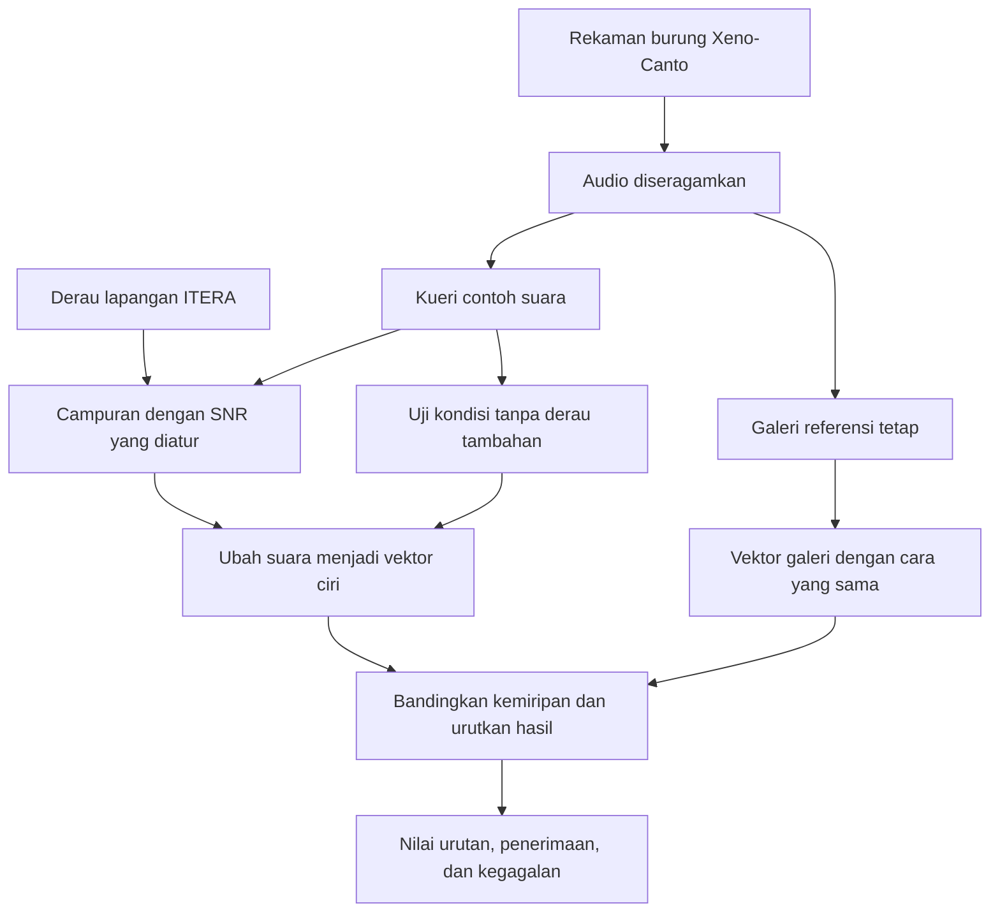

# Memahami penelitian sendiri sebelum bimbingan

Panduan belajar Fabio — 20 Oktober 2026. Mengikuti sumber dan hasil aktif yang diperiksa pada tanggal ini. Bahasa sederhana di sini merupakan alat belajar; judul, RQ, hipotesis, metode, dan hasil resmi tidak diganti oleh panduan ini.

## 1. Cerita penelitian dalam satu menit

Bayangkan Anda mempunyai lemari berisi rekaman dari beberapa jenis burung. Anda membawa satu contoh suara, lalu meminta komputer: **“Carikan rekaman burung yang jenisnya sama dengan contoh ini.”**

Komputer perlu mengubah suara menjadi sekumpulan angka agar bisa membandingkannya. Penelitian ini membandingkan tiga cara membuat angka tersebut, ditambah satu kontrol acak. Setelah itu, contoh suara sengaja dicampur dengan gangguan lingkungan ITERA. Kita melihat cara mana yang hasil pencariannya paling bertahan.

Pertanyaan berikutnya: kalau suara berasal dari jenis burung yang tidak masuk koleksi target, atau hanya derau, apakah sistem bisa menolak? Kalau gangguannya berasal dari lokasi ITERA berbeda, apakah hasil berubah? Saat pencarian gagal, bagaimana bentuk kegagalannya?

**Intinya: penelitian perbandingan ketahanan pencarian rekaman burung terhadap derau.** Model yang sudah ada dipakai tanpa dilatih ulang. Suara burung target berasal dari Xeno-Canto; derau lapangan berasal dari ITERA; keduanya dicampur secara terkontrol di komputer.

## 2. Membaca judul tanpa tersandung istilah

Topik payung yang tercantum di repositori adalah **“Mencari Audio yang Mirip Ketika Datanya Terbatas.”** Judul artikel kerja yang tercantum di README:

> Noise and Spectral Sensitivity of Frozen Audio Representations for Bioacoustic Similarity Retrieval: A Controlled Evaluation on Indonesian Avifauna with Field-Recorded ITERA Tropical Noise

Untuk menjelaskan maksudnya, Anda boleh mengatakan:

**“Saya membandingkan cara merangkum ciri suara burung untuk mencari rekaman sejenis, lalu menguji apakah pencariannya tetap bagus saat contoh suaranya diberi gangguan lingkungan ITERA.”**

| Potongan judul | Maksudnya |
|---|---|
| Audio representations | Cara menggambarkan ciri suara dengan angka. |
| Frozen | Bobot model sudah ditetapkan dan tidak dilatih ulang dalam penelitian ini. Suara berbeda tetap bisa menghasilkan angka berbeda. |
| Bioacoustic | Suara yang berhubungan dengan makhluk hidup; dalam penelitian ini fokusnya suara burung. |
| Similarity retrieval | Mencari rekaman dari koleksi berdasarkan kemiripan dengan contoh suara. |
| Avifauna | Burung-burung dalam suatu wilayah; bukan nama suatu model. |
| Controlled evaluation | Kondisi pengujian diatur agar perbandingan dapat ditelusuri dan cukup adil. |
| Field-recorded noise | Gangguan benar-benar direkam di lapangan. Namun campurannya dengan suara target dibuat di komputer. |
| Spectral sensitivity | Perhatian pada susunan frekuensi suara dan kaitannya dengan kegagalan. Belum membuktikan mekanisme frekuensi sebagai penyebab perbedaan antarlokasi. |

Kata “data terbatas” menjelaskan konteks pemanfaatan model yang sudah dilatih dan koleksi target yang terbatas. Penelitian ini **tidak** menjalankan percobaan khusus dengan jumlah data yang terus diperkecil untuk membuktikan sebuah algoritme few-shot baru.

## 3. Apa sebenarnya yang dicari?

**Query/kueri** adalah contoh suara yang kita masukkan. **Gallery/galeri** adalah koleksi rekaman pembanding. Hasilnya berupa daftar rekaman yang diurutkan dari skor kemiripan tertinggi.

Contoh: kueri diberi label spesies A. Sistem mencari di galeri dan menempatkan rekaman spesies B di urutan pertama, lalu A di urutan kedua. Hasil pertama salah, tetapi masih ada rekaman yang benar di hasil berikutnya.

Dalam evaluasi ini, hasil disebut **relevan** bila label spesiesnya sama dengan kueri. Tidak harus individu burung yang sama, tidak harus file yang sama, dan tidak harus bunyi panggilan yang persis sama. Label acuan dipakai untuk memeriksa hasil setelah pencarian, bukan dimasukkan ke rumus kemiripan agar sistem tahu jawabannya.

Retrieval berbeda dari sekadar memberi satu label klasifikasi. Sistem pencarian menghasilkan urutan rekaman; label spesies dipakai untuk menilai urutan tersebut. BirdNET memang berasal dari model pengenalan burung, tetapi penelitian ini mengambil angka cirinya, bukan langsung memakai keluaran nama spesies sebagai hasil klasifikasi.

## 4. Data yang dipakai dan fungsi masing-masing

| Data | Jumlah | Fungsi |
|---|---:|---|
| Rekaman target Xeno-Canto | 1.216 file, 20 spesies Indonesia | Koleksi utama penelitian. |
| Galeri | 673 rekaman target | Tempat sistem mencari jawaban. |
| Kueri evaluasi | 311 rekaman target | Soal untuk mengukur hasil pencarian. |
| Kalibrasi target | 232 rekaman target | Membantu menentukan batas penerimaan pada E3. |
| Bank derau AudioMoth ITERA | 1.799 file | Sumber gangguan lapangan. |
| Derau untuk pencampuran | 1.528 file dari bank | Pool pencampuran E2/E4. |
| Derau khusus unknown | 271 file dari bank | Derau yang disisihkan sebagai masukan non-target E3. |
| Burung non-target | 272 rekaman | Jenis burung di luar target untuk E3. |
| Unknown total | 543 = 272 + 271 | Dibagi menjadi 233 untuk kalibrasi dan 310 untuk evaluasi. |

Pemeriksaan pembagian utama: **673 + 311 + 232 = 1.216**. Angka unknown bukan tambahan spesies target. Derau unknown merupakan bagian dari bank 1.799; jangan dijumlahkan lagi seolah file yang seluruhnya berbeda.

Kelima lokasi derau: Kebun Raya, Embung F, Gedung F, Masjid At Tanwir, dan sekitar GKU 1. Bank mencakup **enam konfigurasi perekaman**: kelompok Amplitudo/Frequency masing-masing Low/Medium/High. Itu tidak berarti enam perangkat AudioMoth fisik.

**Mengapa 20 spesies?** Itu batas cakupan penelitian berdasarkan data yang tersedia dan syarat kecukupan rekaman/perekam. Batas pemilihan aktif mencakup sedikitnya 30 rekaman dan 14 perekam per spesies. Ini membantu menyediakan contoh yang dapat dibagi; bukan rumus statistik yang mengharuskan semua penelitian memakai 20. Hasilnya tidak otomatis mewakili semua burung Indonesia.

**Mengapa perekam dipisah?** Bayangkan file dari orang yang sama masuk galeri dan kueri. Suara mikrofon atau latar khasnya bisa membantu pencarian secara tidak sengaja. Pembagian berdasarkan identitas perekam mengurangi kebocoran semacam itu. Audit pembagian internal tidak membuktikan bahwa model pretrained belum pernah melihat rekaman terkait selama pelatihan asalnya.

Tidak ada bagian data lokal untuk melatih ulang bobot model. Jadi jangan menyebut 673/311/232 sebagai training/test/validation model. Perannya adalah **referensi pencarian, evaluasi, dan kalibrasi ambang**.

Daftar berikut memakai nama ilmiah dan nama umum yang tercatat pada metadata penelitian, bukan pembaruan taksonomi baru:

| Nama ilmiah di data | Nama umum di data | Rekaman |
|---|---|---:|
| Orthotomus ruficeps | Ashy Tailorbird | 30 |
| Todiramphus chloris | Collared Kingfisher | 40 |
| Aegithina tiphia | Common Iora | 39 |
| Spilornis cheela | Crested Serpent Eagle | 35 |
| Culicicapa ceylonensis | Grey-headed Canary-flycatcher | 38 |
| Ducula aenea | Green Imperial Pigeon | 45 |
| Dicrurus hottentottus | Hair-crested Drongo | 91 |
| Pitta sordida | Hooded Pitta | 62 |
| Malacocincla sepiaria | Horsfield's Babbler | 68 |
| Caprimulgus macrurus | Large-tailed Nightjar | 47 |
| Brachypteryx leucophris | Lesser Shortwing | 66 |
| Phyllergates cucullatus | Mountain Tailorbird | 137 |
| Cinnyris jugularis | Olive-backed Sunbird | 123 |
| Pnoepyga pusilla | Pygmy Cupwing | 105 |
| Cacomantis sepulcralis | Rusty-breasted Cuckoo | 85 |
| Caprimulgus affinis | Savanna Nightjar | 31 |
| Pycnonotus aurigaster | Sooty-headed Bulbul | 44 |
| Horornis vulcanius | Sunda Bush Warbler | 48 |
| Cuculus lepidus | Sunda Cuckoo | 42 |
| Brachypteryx montana | White-browed Shortwing | 40 |

## 5. Metode dari file suara sampai hasil

Langkah praktisnya:

1. Baca file dan metadata, lalu gunakan pembagian data yang sudah dibekukan.
2. Ubah ke satu kanal atau **mono**, 32.000 sampel per detik, dan panjang 5 detik. Audio pendek diberi pengisi nol; audio panjang dipilih dengan jendela energi tertinggi. Atur skala amplitudonya melalui RMS.
3. Buat vektor galeri dengan setiap metode. Galeri tetap tanpa derau tambahan.
4. Buat vektor kueri clean atau kueri yang telah dicampur derau sesuai eksperimen.
5. Bandingkan kueri dengan seluruh 673 vektor galeri menggunakan cosine similarity. Urutkan skor dari tinggi ke rendah.
6. Cocokkan label spesies untuk menghitung kualitas pencarian. Untuk E3, periksa juga apakah skor tertinggi melampaui batas penerimaan.

**Clean** di sini berarti tidak ditambahi derau eksperimen. Rekaman aslinya belum tentu hening sempurna.

**32 kHz** berarti komputer menyimpan 32.000 titik pengukuran gelombang setiap detik. Itu berbeda dari frekuensi nada seekor burung. Lima detik pada 32 kHz berisi 160.000 titik. Durasi dan laju sampel diseragamkan supaya masukan sebanding; penelitian ini tidak membuktikan bahwa 5 detik adalah durasi paling baik untuk semua suara burung.

Pemilihan jendela berenergi tertinggi adalah aturan otomatis yang praktis. Suara paling kuat juga bisa berupa gangguan. Ini salah satu alasan inspeksi kasus tetap diperlukan.

## 6. Apa itu fitur, representasi, embedding, dan model?

**Fitur** adalah ciri yang diukur dari suara. **Representasi** adalah bentuk angka yang dipakai untuk menggambarkannya. **Vektor** berarti daftar angka. **Embedding** biasanya merujuk pada vektor ciri yang dipelajari oleh model.

Analogi: Anda ingin membandingkan dua makanan tanpa membawa makanannya. Anda mencatat ciri-cirinya. Pada suara, catatannya berupa angka yang membantu komputer membandingkan pola. Untuk embedding, setiap angka tidak selalu bisa diterjemahkan menjadi “ini kerasnya” atau “ini tinggi nadanya”. Angkanya bekerja bersama sebagai pola.

Istilah “sidik jari suara” boleh menjadi analogi awal, tetapi jangan diartikan sebagai identitas unik yang pasti benar.

| Kode | Cara membuat ciri | Ukuran vektor | Alasan dibandingkan |
|---|---|---:|---|
| R0 | MFCC: perhitungan ciri spektral klasik | 40 angka | Pembanding sederhana tanpa model pretrained. |
| R1 | PANNs CNN14, pretrained pada berbagai suara AudioSet | 2.048 angka | Menguji manfaat pengetahuan audio yang umum. |
| R2 | Backbone BirdNET V2.4, pretrained dengan fokus burung | 1.024 angka | Menguji manfaat pengetahuan yang lebih dekat dengan suara burung. |
| R3 | Angka acak deterministik dari identitas rekaman | 40 angka | Kontrol yang sengaja tidak membaca bunyi. |

R0 aktual merangkum 20 koefisien MFCC melalui rata-rata dan simpangan baku, menjadi 40 angka. MFCC menggambarkan pola bentuk spektrum dalam skala yang terkait persepsi frekuensi. Ia bukan sekadar ukuran volume. Ringkasan rata-rata/simpangan baku membuat urutan waktu yang rinci tidak dipertahankan.

R1 memanfaatkan model yang pernah mempelajari beragam suara. R2 memanfaatkan model dengan domain burung. Namun model berbeda juga mempunyai arsitektur dan data pelatihan asal yang berbeda. Jika R2 lebih baik, kita tidak bisa menyimpulkan satu faktor tunggal pasti menjadi penyebabnya.

R3 memberi vektor yang sama untuk identitas yang sama pada clean maupun noisy. Karena tidak membaca gelombang suara, performanya dapat tetap sama ketika derau berubah. Retensi 100% R3 **bukan** bukti kemampuan mendengar yang sangat tahan derau.

Jadi ucapan yang lebih tepat adalah **“tiga representasi audio dan satu kontrol acak”**, bukan empat model AI yang semuanya belajar suara.

**Mengapa tidak dilatih ulang?** Fokusnya membandingkan kemampuan representasi yang sudah tersedia dalam kondisi data target terbatas. Pelatihan ulang akan menambah faktor yang berubah: data pelatihan, pengaturan pelatihan, dan proses pemilihan model. Penelitian ini memilih mengunci bobot. Itu batas desain, bukan pernyataan bahwa fine-tuning tidak berguna.

**Mengapa dimensi berbeda?** Ukuran mengikuti keluaran metode/model. Lebih banyak angka tidak otomatis lebih bagus. Vektor R1 hanya dibandingkan dengan galeri R1, R2 dengan galeri R2, dan seterusnya.

## 7. Kemiripan dihitung bagaimana?

**Cosine similarity** membandingkan arah dua vektor. Jika arah polanya mirip, skornya tinggi. Normalisasi L2 membuat panjang vektor menjadi satu agar perbandingan berfokus pada arah.

Contoh kecil: `[3, 4]` dan `[6, 8]` memiliki arah yang sama, sehingga cosine-nya 1. `[3, 4]` dan `[4, -3]` saling tegak lurus, sehingga cosine-nya 0. Angka nyata mempunyai puluhan atau ribuan dimensi.

Rumusnya:

`cosine(q,g) = jumlah(q_i × g_i) / (panjang(q) × panjang(g))`.

Skor ini **bukan peluang spesies benar**. Skor 0,75 tidak berarti peluang benar 75%. Skala skor antarmetode juga berbeda; threshold MFCC yang lebih tinggi tidak membuktikan MFCC lebih yakin atau lebih baik.

## 8. SNR: apa itu +20, +10, 0, dan −5 dB?

SNR adalah perbandingan daya suara yang ingin dicari dengan daya gangguan. Satuan yang digunakan **dB**, sehingga katakan “SNR plus dua puluh desibel”, bukan “dua puluh SNR”.

`SNR_dB = 10 × log10(daya sinyal / daya derau)`.

| SNR | Perbandingan daya sinyal : derau | Makna |
|---|---|---|
| +20 dB | 100 : 1 | Daya sinyal jauh lebih besar. |
| +10 dB | 10 : 1 | Sinyal masih lebih besar, gangguan meningkat. |
| 0 dB | 1 : 1 | Daya sinyal dan derau sama. Bukan berarti suara hilang. |
| −5 dB | sekitar 1 : 3,16 | Daya derau melebihi daya sinyal. |

Ini perbandingan **daya**, bukan klaim suara terdengar 100 kali lebih keras. Keterdengaran juga bergantung pada frekuensi, pola waktu, dan pendengaran.

Kenapa memilih empat titik tersebut? Untuk memberi tangga uji dari gangguan relatif ringan sampai gangguan yang mendominasi, dengan 0 dB sebagai titik daya setara. Empat kondisi juga membatasi beban percobaan. Ini keputusan cakupan yang dibekukan, **bukan aturan universal atau bukti bahwa kondisi alam selalu tepat pada empat nilai itu**. Sumber aktif tidak membuktikan grid ini merupakan grid yang paling optimal.

Mengapa tidak −10 dB? Bisa menjadi pengembangan, tetapi tidak termasuk rancangan aktif. Jangan membuat alasan seolah −10 mustahil atau dilarang teori.

Derau perlu diatur skalanya supaya perbandingan itu tercapai. Jika `x` adalah suara burung dan `n` adalah derau, campuran dibuat sebagai `y = x + αn`, dengan:

`α = akar(daya_x / (daya_n × 10^(SNR/10)))`.

Contoh pada 0 dB: bila daya x = 0,0025 dan daya n = 0,01, α = 0,5. Setelah amplitudo derau dikalikan 0,5, dayanya menjadi 0,0025, sama dengan daya sinyal. Jika puncak campuran perlu dikecilkan, kedua komponen mendapat pengali bersama sehingga perbandingan dayanya tetap.

## 9. RQ, tujuan, dan hipotesis dalam bahasa biasa

**RQ/rumusan masalah** adalah pertanyaan. **Tujuan** adalah hal yang ingin diketahui dari pertanyaan itu. **Hipotesis** adalah dugaan yang diperiksa, bukan jawaban yang wajib dibenarkan.

RQ utama dalam bahasa sehari-hari:

**“Dari cara-cara yang dibandingkan, mana yang tetap paling bagus mencari rekaman burung sejenis saat contoh suaranya makin tertutup gangguan?”**

| Pertanyaan kecil | Bahasa sehari-hari | Tujuan | Eksperimen |
|---|---|---|---|
| Sub-RQ 1 | Kalau gangguan makin kuat, hasil pencarian turun seberapa jauh? | Mengukur penurunan dan hasil yang masih bertahan. | E2, dibandingkan E1. |
| Sub-RQ 2 | Batas skor dari suara clean masih berguna untuk menerima/menolak suara bising? | Memeriksa perilaku penerimaan target dan penolakan non-target. | E3. |
| Sub-RQ 3 | Kalau derau diambil dari lokasi berbeda, apakah hasil berubah banyak? | Mengukur sensitivitas terhadap profil derau lokasi. | E4. |
| Sub-RQ 4 | Saat sistem gagal, salahnya seperti apa dan ciri apa yang menyertainya? | Mengelompokkan serta memeriksa kegagalan. | E5. |

| Hipotesis aktif | Dugaan dalam bahasa biasa | Cara membaca hasilnya |
|---|---|---|
| H1 | Representasi dari model pretrained mempertahankan bagian skor clean lebih besar daripada MFCC. | Didukung hasil retensi yang diuji; bukan berarti semua model pretrained selalu unggul. |
| H2 | BirdNET mempertahankan bagian skor clean lebih besar daripada PANNs pada campuran derau ini. | Didukung hasil aktif dalam cakupan data dan kondisi ini. |
| H3 hasil reformulasi | Seberapa lebar perubahan hasil BirdNET dibanding PANNs ketika lokasi derau berganti? | Eksploratif. Interpretasi bergantung pada metrik, SNR, dan lokasi yang disertakan. |
| H4 hasil reformulasi | Ambang dari clean dapat berubah perilakunya saat kueri bising. | Eksploratif dalam pelaporan reformulasinya. Target lebih banyak tertolak; FPR unknown tidak naik seperti dugaan kenaikan false accept. |
| H5 | Tiga cara yang membaca audio memberikan clean retrieval lebih baik daripada kontrol acak. | Didukung hasil clean; MFCC termasuk metode yang membaca audio. |

H3/H4 awal tercatat 6 September 2026. Reformulasi tercatat 12 Oktober setelah hasil tersedia; pelaporan diperluas 15 Oktober. **Eksploratif** berarti analisis atau rumusan diperjelas setelah melihat hasil, sehingga tidak boleh dipresentasikan seolah seluruh rumusan dibekukan sebelum melihat data.

H3 awal membandingkan real soundscape dengan campuran terkontrol dan menyebut pengaruh jarak, penyerapan udara, serta gema. **Pertanyaan asli itu belum diuji**. E4 aktif membandingkan campuran menggunakan derau dari lima lokasi. Untuk H4, klausul penurunan recall sudah ada pada rumusan asli; jangan mengatakan semua bagian H4 baru muncul setelah hasil.

## 10. E0 sampai E5: masing-masing mengerjakan apa?

**E0 — Memastikan alat ukurnya bekerja.** Sebelum membandingkan kualitas pencarian, periksa apakah audio bisa dibaca, panjang keluaran sesuai, angka valid, dan ukuran vektor benar. Audit teknis memakai sampel deterministik 100 rekaman dari 20 spesies. Tidak ditemukan kegagalan decode, panjang, atau angka non-finite pada pemeriksaan itu; ada enam ketidakcocokan ekstensi dan kontainer. Ketidakcocokan itu tidak sama dengan enam audio rusak. E0 bukan mengukur siapa model paling akurat.

**E1 — Mengukur titik awal.** Sebanyak 311 kueri clean dicari ke galeri tetap 673 rekaman dengan R0–R3. Ini memberi patokan sebelum derau tambahan diberikan.

**E2 — Menaikkan gangguan.** Kueri dicampur derau pada +20, +10, 0, dan −5 dB. Bandingkan skor dengan clean. E2 memakai satu pasangan derau per kueri yang dipertahankan antar-SNR/metode; empat ulangan per kondisi adalah rancangan E4, bukan E2. Ada 4.976 evaluasi noisy atau 6.220 bila clean untuk empat representasi ikut dihitung.

**E3 — Memberi pilihan “tidak cukup cocok”.** Pencarian biasa selalu bisa mengembalikan skor tertinggi, termasuk untuk derau murni. E3 membuat batas penerimaan dari kalibrasi clean (232 known + 233 unknown). Batas tersebut dibekukan, lalu diuji pada 311 known dan 310 unknown per kondisi. Kita memeriksa target yang diterima dan unknown yang keliru diterima secara terpisah.

**E4 — Mengganti sumber gangguan.** Setiap kueri diuji memakai derau dari lima lokasi, empat SNR, dan empat ulangan pilihan segmen. Hitungannya **311 × 5 × 4 × 4 = 24.880 evaluasi noisy per representasi**, atau 99.520 untuk empat representasi. Itu bukan 99.520 rekaman burung independen. E4 tidak dijalankan ulang saat revisi; statistik dihitung kembali dari hasil tersimpan. Membatasi E4 menjadi satu lokasi akan menghilangkan pertanyaan tentang variasi lokasi.

**E5 — Memeriksa kegagalan.** Diagnostik komputer mengelompokkan kasus salah/tertolak dan memakai fitur/skor yang tersedia. Sebanyak 120 baris kasus pilihan disiapkan untuk diperiksa manusia. Baris itu mencakup 80 kueri unik dan 117 pasangan kueri-kondisi; bukan 120 burung atau 120 rekaman independen. Paket dengar mempunyai 276 klip unik. Ini kasus pilihan untuk diagnosis, bukan sampel acak untuk memperkirakan tingkat kesalahan seluruh populasi.

Bedakan tiga kode: **R0–R3 = cara membuat vektor; E0–E5 = tahap percobaan; H1–H5 = dugaan yang diperiksa.**

## 11. Menghitung hasil pencarian dengan contoh kecil

Bayangkan galeri berisi tiga rekaman yang spesiesnya benar untuk satu kueri. Lima hasil pertama adalah:

| Urutan | Hasil relevan? | Jumlah benar sampai urutan ini | Precision sampai sini |
|---:|---|---:|---:|
| 1 | Ya | 1 | 1/1 = 1 |
| 2 | Tidak | 1 | 1/2 = 0,5 |
| 3 | Ya | 2 | 2/3 ≈ 0,6667 |
| 4 | Ya | 3 | 3/4 = 0,75 |
| 5 | Tidak | 3 | 3/5 = 0,6 |

**Top-1:** benar karena urutan pertama cocok. Untuk banyak kueri, hitung proporsi kueri yang hasil pertamanya benar.

**Precision@5:** dari lima hasil yang ditampilkan, berapa yang benar? Jawabannya 3/5 = 0,6.

**Recall@5:** dari seluruh rekaman relevan yang tersedia di galeri, berapa yang ditemukan di lima hasil? Jawabannya 3/3 = 1.

**AP@5:** menilai keberadaan hasil benar sekaligus posisi hasilnya. Implementasi penelitian menjumlahkan precision pada posisi relevan dan membaginya dengan `min(jumlah relevan di galeri, k)`. Contoh: `(1 + 2/3 + 3/4) / 3 ≈ 0,8056`.

**mAP@10:** hitung AP dengan k = 10 untuk setiap kueri, lalu ambil rata-ratanya. Pada penelitian aktual, rata-rata itu dihitung atas 311 kueri. Nilai 0,6367 adalah skor rata-rata kualitas urutan; **bukan** berarti 63,67% nama burung benar di urutan pertama.

**MRR:** hanya melihat posisi hasil benar pertama. Bila baru ada di urutan kedua, nilai kueri itu 1/2. Kemudian rata-ratakan antar-kueri.

### Mengapa Recall@10 tidak bisa selalu mencapai 100%?

Jika ada 50 rekaman spesies yang benar di galeri tetapi kita hanya mengambil sepuluh hasil, hasil sempurna pun hanya mencakup 10/50 = 20%. Secara umum batasnya `min(1, 10/jumlah_relevan)`.

Pada data aktif, jumlah relevan per spesies di galeri berkisar 15–100. Batas Recall@10 tiap kueri pun berbeda. Batas rata-rata yang dibobot sesuai 311 kueri sekitar **0,3640**, bukan 1. Nilai R2 clean sekitar 0,2331 perlu dibaca dengan penyebut ini. Ini tidak berarti Recall@10 tidak berguna; semua metode memakai galeri dan kueri yang sama, sehingga masih dapat dibandingkan.

Penyebut Recall@10 bukan otomatis 673 seluruh galeri dan bukan 311 jumlah kueri; penyebutnya jumlah rekaman dari spesies kueri di galeri.

## 12. Hasil utama dan artinya

| Cara | mAP@10 clean | Top-1 clean | mAP@10 pada −5 dB | Skor clean yang bertahan pada −5 dB |
|---|---:|---:|---:|---:|
| R0 MFCC | 0,0694 | 18,33% | 0,0232 | 33,45% |
| R1 PANNs | 0,1763 | 37,62% | 0,0863 | 48,96% |
| R2 BirdNET | 0,6367 | 81,67% | 0,4832 | 75,88% |
| R3 kontrol acak | 0,0211 | 6,43% | 0,0211 | 100%, karena tidak membaca audio |

R2 memberi hasil terbaik di antara representasi audio yang dibandingkan pada data ini. Pada clean, hasil pertama benar untuk **254 dari 311** kueri. Pada E2 −5 dB, hasil pertama benar untuk **210 dari 311**, sekitar 67,52%.

Retensi R2 dihitung sebagai `0,483160 / 0,636709 × 100% ≈ 75,88%`. Jadi penurunan relatifnya sekitar 24,12%, sedangkan penurunan skor absolutnya sekitar 0,15355. Ini tiga cara menyampaikan perubahan yang sama dengan penyebut berbeda.

Jangan menyatakan semua skor selalu turun pada setiap penambahan derau. Ada kenaikan kecil pada kondisi ringan tertentu. Mengetahui skor naik belum membuktikan mekanismenya; jangan langsung menyebut derau membantu karena alasan biologis tertentu.

### E3: bagaimana batas penerimaan bekerja?

Batas τ* R2 sekitar **0,7028**. Jika skor tertinggi 0,75, kueri diterima; jika 0,65, ditolak. τ* dibentuk dari data kalibrasi, bukan dipilih agar hasil evaluasi terlihat bagus. Dalam E3 batas itu tidak disetel ulang setiap SNR.

Cara memilihnya memakai **Youden J = proporsi known yang diterima − proporsi unknown yang keliru diterima**, dihitung pada kalibrasi clean. Kandidat ambang dibandingkan dan kandidat dengan J terbesar menurut aturan kode dipilih. Contoh hipotetis: calon A menerima 80% known tetapi juga 40% unknown, sehingga J = 0,40; calon B menerima 65% known dan 15% unknown, sehingga J = 0,50. Menurut ukuran ini B lebih baik, meskipun menerima lebih sedikit known. Ini bukan janji bahwa ambang itu optimal di semua kondisi atau untuk semua biaya kesalahan.

Untuk R2, proporsi known yang diterima turun dari **188/311 = 60,45%** pada clean menjadi **79/311 = 25,40%** pada −5 dB. Unknown yang keliru diterima turun dari **69/310 = 22,26%** menjadi **40/310 = 12,90%**.

Artinya, pada kondisi ini sistem lebih sering menolak, termasuk menolak target yang seharusnya dapat dilayani. FPR yang turun saja tidak cukup untuk menyatakan sistem makin bagus. **Recall penerimaan E3 tidak sama dengan Recall@10 dan tidak sama dengan Top-1.** Sebuah kueri bisa mempunyai hasil pertama spesies benar tetapi ditolak karena skornya tidak melewati ambang.

### H3: relatif dan absolut jangan dicampur

Ayunan adalah lebar perubahan ketika lokasi derau diganti. Implementasi menghitung skor tertinggi dikurangi terendah lintas lokasi dalam setiap ulangan, lalu merata-ratakan empat ulangan. Untuk ringkasan berikut, hasil empat SNR juga dirata-ratakan.

| Ayunan rata-rata lima lokasi | R1 PANNs | R2 BirdNET |
|---|---:|---:|
| Skor mAP@10 absolut | 0,042324 | 0,030949 |
| Dibagi skor clean masing-masing | 0,240111 | 0,048607 |

Mengapa perbandingannya terlihat jauh berbeda? Skor clean R1 lebih kecil. Contoh hipotetis: ayunan 0,04 dari clean 0,16 setara 25% baseline; ayunan 0,04 dari clean 0,64 setara 6,25% baseline. Lebar absolutnya sama tetapi relatifnya berbeda.

Pada hasil aktual lima lokasi, selisih ayunan absolut rata-rata belum meyakinkan: CI 95% selisih R1−R2 mencakup nol, sekitar **[−0,003993; 0,022140]**. Pada −5 dB, ayunan absolut R2 malah lebih lebar: 0,061829 dibanding 0,045596 R1.

Tanpa Kebun Raya, selisih ayunan relatif rata-rata R1−R2 mengecil dari 0,191504 menjadi 0,069097. Pada subset itu di −5 dB, ayunan relatif R2 juga lebih lebar secara nilai titik. Analisis tambahan membuang satu lokasi secara bergantian sudah tersedia. Kesimpulan yang tepat: **gambaran stabilitas bergantung pada ukuran absolut/relatif, SNR, serta komposisi lokasi**.

Jangan berkata “BirdNET lebih stabil di semua SNR dalam semua ukuran”. Jangan memastikan penyebabnya serangga, gema, atau distorsi frekuensi; dugaan mekanisme itu belum diuji langsung.

## 13. Istilah E5: centroid, bandwidth, margin, dan kegagalan

**Spektrum** menunjukkan isi suara menurut frekuensi: seberapa besar bagian rendah dan bagian tingginya. **Spectrogram** memperlihatkan perubahan spektrum sepanjang waktu. Frekuensi tinggi tidak sama dengan suara keras.

**Spectral centroid** adalah semacam titik berat frekuensi. Bila bobot suara banyak berada pada frekuensi tinggi, centroid cenderung lebih tinggi. Contoh sederhana: komponen 1.000 Hz berbobot 1 dan 3.000 Hz berbobot 3 memberi centroid `(1000×1 + 3000×3)/(1+3) = 2500 Hz`.

Implementasi fitur merangkum centroid per bingkai waktu menjadi rata-rata. Centroid bukan nama spesies, bukan selalu frekuensi yang paling dominan, dan tidak dapat sendirian membuktikan bahwa suatu rekaman mengandung serangga.

**Spectral bandwidth** adalah ukuran sebaran frekuensi di sekitar centroid. Bayangkan dua kelompok siswa: keduanya punya tinggi rata-rata sama, tetapi salah satunya lebih bervariasi. Bandwidth menggambarkan lebar sebaran itu pada frekuensi. Ini bukan bandwidth internet, dan nilai besar tidak otomatis berarti audio rusak.

**Similarity margin** adalah jarak skor dari suatu batas/pembanding. Dua bentuk jangan tertukar:

- `margin_to_tau = skor_tertinggi − τ`: positif berarti melewati batas; negatif berarti tertolak. Skor 0,65 dengan τ 0,7028 memberi margin −0,0528. Jika memakai kata “defisit”, besarnya kekurangan menuju ambang adalah 0,0528.
- Margin kelas membandingkan skor spesies benar dengan skor spesies lain. Ini pertanyaan berbeda dari diterima atau ditolak oleh τ.

**Top-1 confusion:** hasil pertama memiliki spesies yang salah. **False rejection:** target yang termasuk cakupan justru ditolak. **False acceptance:** suara non-target diterima. Untuk known pada E5, aturan kategori menggabungkan dua keputusan berikut:

| Hasil pertama | Skor melewati ambang | Skor di bawah ambang |
|---|---|---|
| Spesies benar | Accepted correct: hasil pertama benar dan diterima. | Open-set false rejection: hasil pertama benar tetapi tertolak. |
| Spesies salah | Top-1 confusion above threshold: hasil pertama salah tetapi diterima. | Total retrieval collapse: hasil pertama salah sekaligus tertolak. |

**Total retrieval collapse** berarti kegagalan ganda menurut aturan ini. Istilah tersebut tidak menyatakan bahwa sepuluh hasil semuanya salah atau tidak ada rekaman relevan di seluruh urutan. Penolakan known dalam E3 mencakup kedua sel di kolom kanan, sedangkan label kategori false rejection E5 secara khusus memakai sel kanan atas.

Nilai fitur dan kesalahan yang muncul bersama hanya menunjukkan hubungan/deskripsi. Menyimpulkan “centroid tinggi menyebabkan model gagal” memerlukan pengujian tambahan yang memisahkan faktor lain. Identitas Top-1, margin, atau fitur yang tidak tersimpan untuk E4 tidak boleh diisi dengan tebakan.

## 14. Siapa yang mendengar 120 kasus E5 dan bagaimana?

Anda sebagai peneliti dapat melakukan audit pendengaran awal. Tidak perlu menulis seolah pakar sudah memverifikasi spesies bila belum ada pakar yang terlibat. Orang kedua dapat menambah pemeriksaan silang; keterlibatan pakar diperlukan bila hendak membuat klaim identifikasi yang membutuhkan keahlian di luar kemampuan pendengar.

Gunakan paket dengar yang segmen dan campurannya mengikuti eksperimen, bukan potongan berbeda dari file aslinya. Buka halaman pemutar lokal, dengarkan contoh clean, campuran noisy, dan pembanding yang tersedia. Pertahankan pengaturan volume yang wajar dan konsisten. Catat apa yang terdengar, bukan menyalin diagnosis komputer sebagai pendapat telinga.

Untuk setiap kasus, isi identitas pendengar, tanggal, berkas/kasus, apakah suara target masih terdengar, sifat gangguan, hubungan bunyi yang bisa dijelaskan, dan ketidakpastian. Jika tidak dapat memastikan spesies, tulis tidak yakin. Anda tetap bisa mencatat bahwa bunyi target tertutup atau masih terdengar tanpa mengaku mengenali semua spesies.

Lakukan bertahap agar tidak lelah. Jangan menandai 120 selesai hanya karena pemutar/klip sudah dibuat. Pada bukti persiapan, audit formal penuh masih terbuka. Panduan ini tidak menambahkan pengamatan manusia.

Rincian operasional ada di [panduan audit dan penjelasan lisan](../Rencana-eksperimen-bimbingan/PANDUAN_AUDIT_E5_DAN_PENJELASAN_LISAN.md) dan [README audit](../Rencana-eksperimen-bimbingan/audit-pendengaran-E5/README.md).

## 15. Variabel dan alasan perbandingannya cukup adil

| Jenis | Dalam penelitian ini |
|---|---|
| Variabel bebas: hal yang dibedakan | Representasi R0–R3, tingkat SNR, dan profil lokasi derau pada E4. |
| Variabel terikat: hasil yang diukur | mAP@10, Recall@10, Top-1, retensi, penerimaan known, FPR unknown, serta diagnostik kegagalan. |
| Hal yang dikendalikan | Galeri/kueri, pembagian data, persiapan audio, cara mengurutkan, nilai k, pasangan derau sesuai rancangan, dan ambang E3 setelah kalibrasi. |
| Pengulangan | Empat pilihan segmen derau per kondisi E4. Ini bukan empat kelompok burung yang independen. |

Pemakaian kueri yang sama memungkinkan perbandingan berpasangan: kueri yang sulit bagi satu metode juga diperiksa oleh metode lain. Ini mengurangi perubahan yang hanya timbul karena soal ujinya berbeda.

Konfigurasi perekaman, lokasi, isi latar, dan perangkat dapat saling terkait. Lokasi yang skornya berbeda belum otomatis berarti ekologi lokasi itulah penyebabnya. Penelitian tidak mengisolasi semua faktor lapangan secara terpisah.

## 16. Bootstrap, CI, dan mengapa “sudah diuji” belum berarti pasti

**Bootstrap** membuat banyak sampel ulang dari kueri yang sudah ada, dengan pengembalian. Satu kueri boleh terambil lebih dari sekali dalam sampel ulang. H3 memakai 10.000 pengulangan; indeks kueri yang sama dipakai untuk pasangan metode dan kondisi.

Analogi: Anda ingin tahu apakah selisih hasil tetap terlihat ketika komposisi soal berubah sedikit. Anda mengacak ulang kumpulan soal yang sama berkali-kali dan melihat sebaran selisihnya. Itu **bukan** merekam 10.000 burung baru atau menjalankan E4 dari awal 10.000 kali.

**CI 95%** adalah rentang ketidakpastian yang dihitung dengan prosedur statistik. Jika rentang selisih melewati nol, bukti arah keunggulan belum meyakinkan menurut analisis itu; ini tidak membuktikan kedua cara persis sama. H3 tetap bersyarat pada lokasi dan segmen derau yang sudah dipilih.

**p-value** bukan peluang bahwa hipotesis benar. Untuk bimbingan awal, pahami dulu arah/besar selisih dan CI sebelum menghafal angka p.

Beberapa istilah tambahan yang sering muncul:

| Istilah | Arti singkat |
|---|---|
| Known / unknown | Masukan dari spesies target / masukan di luar target, termasuk derau. Bukan “suara yang manusia kenal atau tidak kenal”. |
| Domain | Lingkungan atau kumpulan karakteristik data. |
| Domain shift | Karakteristik data berubah dari kondisi asal; pada E4 yang benar-benar diuji adalah variasi profil derau dalam campuran. |
| Pretrained / checkpoint | Model yang sudah dilatih sebelumnya / berkas bobot hasil pelatihannya. |
| Backbone | Bagian model yang menghasilkan ciri, sebelum keluaran keputusan akhirnya. |
| Fine-tuning | Melatih kembali sebagian/seluruh bobot pada data baru. Tidak dilakukan pada perbandingan ini. |
| Baseline | Titik pembanding awal. Bisa berupa metode sederhana atau hasil clean, tergantung konteks kalimat. |
| Ground truth | Jawaban acuan dari label/metadata untuk memeriksa hasil. |
| Leakage | Informasi yang semestinya terpisah ternyata bocor sehingga hasil terlihat terlalu mudah. |
| FPR / FAR unknown | Bagian unknown yang keliru diterima. Di sini dibaca sebagai proporsi masukan non-target. |
| AUROC | Ringkasan kemampuan skor membedakan known dan unknown ketika ambang digeser. Tidak sama dengan keberhasilan pada satu ambang beku. |
| F1 | Gabungan precision penerimaan dan recall penerimaan, bukan AP atau Top-1. |
| RMS | Ukuran besar amplitudo rata-rata secara kuadratik, terkait daya sinyal. |
| Seed | Nilai pengatur pengacakan agar pilihan yang sama dapat dibangun ulang. |
| Hash SHA-256 | Sidik jari berkas untuk memeriksa identitas isi, bukan penilaian kualitas suara. |
| Cache | Simpanan hasil perhitungan agar tidak perlu dihitung lagi. |
| Reproducibility | Hasil dapat dibangun/diperiksa kembali dari bahan dan prosedur yang tercatat. |

Nilai skor, label spesies, dan catatan pendengar adalah jenis bukti berbeda. Menyamakan ketiganya dapat menghasilkan kesimpulan yang terlalu jauh.

## 17. Landasan, gap, manfaat, dan kontribusi

Landasan penelitian mempunyai beberapa lapisan:

1. Audio dapat diringkas lewat ciri spektral klasik seperti MFCC.
2. Model pretrained dapat menyediakan embedding yang digunakan kembali untuk tugas lain tanpa melatih ulang seluruh model.
3. Pencarian berbasis contoh mengurutkan galeri menurut kemiripan; kualitas urutannya dinilai dengan ukuran information retrieval.
4. SNR memberi cara mengatur perbandingan daya sinyal dan gangguan untuk uji terkontrol.
5. Ambang penerimaan memungkinkan sistem mempunyai pilihan menolak, tetapi menimbulkan pertukaran antara menolak target dan menerima non-target.
6. Pembandingan berpasangan dan bootstrap membantu menilai ketidakpastian hasil.

Sumber primer untuk belajar, bukan bukti langsung hasil TA:

- [Kong dkk., PANNs](https://arxiv.org/abs/1912.10211): model audio umum dan pemanfaatan representasi pretrained.
- [BirdNET, laman resmi](https://birdnet.cornell.edu/): asal model berfokus pada burung.
- [Ghani dkk., 2023](https://www.nature.com/articles/s41598-023-49989-z): penggunaan embedding burung untuk tugas bioakustik lain. Hasil paper tersebut tidak otomatis membuktikan hasil campuran ITERA.
- [Hamer dkk., BIRB](https://arxiv.org/abs/2312.07439): benchmark pencarian bioakustik dan generalisasi ke passive soundscapes. Pertanyaannya berhubungan, tetapi rancangan TA ini berbeda.
- [Stanford IR book: precision dan recall](https://nlp.stanford.edu/IR-book/html/htmledition/evaluation-of-unranked-retrieval-sets-1.html): arti ketepatan dan cakupan hasil pencarian. AP terpotong pada TA tetap mengikuti kode aktualnya.
- [Dokumentasi librosa: spectral centroid](https://librosa.org/doc-playground/latest/generated/librosa.feature.spectral_centroid.html): definisi perhitungan centroid spektral.

**Gap** berarti pertanyaan yang belum terjawab oleh bukti yang Anda gunakan. Kalimat yang dapat dipertanggungjawabkan: “Kemampuan model pada tugas asal atau kondisi clean belum langsung menjawab seberapa baik representasinya untuk pencarian burung Indonesia ketika kueri dicampur derau ITERA, ketika ambang clean dipindahkan ke kondisi bising, dan ketika profil lokasi diganti.”

Jangan menyatakan belum pernah ada penelitian noise, retrieval burung, atau embedding bioakustik. Jangan mengaku pertama di dunia/Indonesia tanpa tinjauan sistematis yang mendukungnya.

**Kontribusi** yang masuk akal adalah protokol perbandingan yang dapat ditelusuri, hasil empiris untuk data/kondisi ini, pemisahan perilaku retrieval dan penolakan, analisis sensitivitas lokasi, serta kasus diagnosis. Anda tidak menemukan MFCC, BirdNET, cosine similarity, atau model AI baru.

**Manfaat ilmiah:** membantu menilai kapan representasi yang berfokus pada burung bermanfaat, sekaligus memperlihatkan batas klaim stabilitas dan ambang clean. **Manfaat praktis:** menjadi dasar pemilihan representasi serta rancangan pemeriksaan lanjutan untuk pencarian rekaman burung. Ini belum membuktikan aplikasi pemantauan biodiversitas lapangan sudah siap dipakai.

## 18. Apa yang sudah dicapai, apa yang masih terbuka?

Data, pembagian, vektor R0–R3, hasil clean/noisy, kalibrasi ambang, E4 lima lokasi, dan diagnosis komputasional E5 tersedia. Reproduksi terisolasi memakai clone serta lingkungan Python baru dengan bahan audio/checkpoint dari arsip lokal; 41/41 pembandingan yang dicatat cocok, selisih maksimum numerik aktual 0,0. Inferensi E4 tidak diulang sesuai arahan pembimbing.

Pada ringkasan tes 18 Oktober, **41 tes lulus, 0 dilewati, 0 gagal, 0 error**. Tes perangkat lunak berbeda dari 41 pembandingan reproduksi, dan keduanya berbeda dari eksperimen ilmiah E0–E5. Tes lulus tidak membuat semua hipotesis otomatis benar.

Yang masih penting: menyelesaikan dan mencatat audit pendengaran 120 kasus, menjaga penjelasan hasil tetap sesuai bukti, serta menulis keterbatasan dengan jujur. Reproduksi dari arsip lokal bukan pengunduhan seluruh bahan dari nol di komputer/OS lain. Campuran bukan real soundscape burung ITERA; belum ada anotasi per kejadian burung in-situ untuk validasi ekologis tersebut. Dua puluh spesies juga bukan seluruh avifauna Indonesia.

## 19. Contoh penjelasan lisan sekitar tiga menit

“Pak, penelitian saya tentang mencari rekaman burung berdasarkan contoh suara. Saya punya koleksi 20 spesies burung Indonesia dari Xeno-Canto. Kalau saya memasukkan satu contoh, sistem mengurutkan rekaman referensi yang dianggap paling mirip. Hasilnya dinilai benar bila spesiesnya sama.

Saya membandingkan MFCC sebagai cara klasik, PANNs sebagai model audio umum, dan BirdNET sebagai model yang berfokus pada burung. Saya juga menambahkan kontrol acak untuk memeriksa apakah hasil yang membaca audio memang lebih berguna daripada kontrol yang mengabaikan bunyi. Model-modelnya saya pakai tanpa dilatih ulang.

Masalah yang saya uji adalah suara contoh tidak selalu bersih. Karena itu, saya mencampurkannya dengan derau lapangan ITERA pada empat tingkat, dari sinyal lebih dominan sampai derau lebih dominan. Galeri tetap, jadi perubahan hasil dapat dibandingkan terhadap kondisi awal.

Urutan percobaannya dimulai dari pemeriksaan teknis, kemudian pencarian clean, pencarian dengan derau bertingkat, pengujian batas penerimaan untuk suara target dan non-target, perbandingan derau lima lokasi, lalu pemeriksaan kasus gagal.

Pada data ini BirdNET memberi hasil pencarian terbaik. Skor mAP@10 clean sekitar 0,6367 dan turun menjadi 0,4832 pada minus lima desibel. Artinya sekitar 75,9 persen skor clean masih bertahan. Ini berbeda dari ketepatan hasil pertama; pada clean hasil pertama benar untuk 254 dari 311 kueri.

Ada batas penting. Ambang yang diambil dari clean semakin sering menolak target ketika bising. Analisis lokasi juga tidak mendukung klaim BirdNET selalu lebih stabil dalam semua ukuran. Karena itu saya melaporkan ayunan absolut dan relatif secara terpisah. Langkah utama berikutnya adalah mendengarkan serta mencatat 120 kasus pilihan untuk melengkapi diagnosis komputer.

Kontribusinya adalah bukti perbandingan dan protokol evaluasi yang dapat ditelusuri untuk kondisi ini, bukan model baru atau bukti bahwa sistem sudah siap memantau burung langsung di lapangan.”

## 20. Pertanyaan yang mungkin muncul saat bimbingan

**Mengapa BirdNET?** Karena pengetahuan asalnya dekat dengan suara burung. Ini alasan pemilihan, sedangkan bukti keunggulannya tetap harus berasal dari hasil uji.

**Kenapa PANNs?** Untuk membandingkan model audio umum dengan model berfokus pada burung. Jika hanya menguji BirdNET, kita tidak tahu manfaatnya dibanding representasi umum.

**Kenapa MFCC?** Sebagai pembanding klasik tanpa pengetahuan pretrained. Kita dapat melihat apakah kompleksitas model memberi manfaat pada kondisi ini.

**Kenapa ada kontrol acak?** Untuk memeriksa bahwa hasil audio benar-benar membawa informasi lebih berguna daripada vektor yang tidak membaca suara. Kontrol ini bukan model kompetitor yang didesain untuk bagus.

**Apakah semua burung direkam di ITERA?** Tidak. Burung target dari Xeno-Canto; derau dari ITERA. Campuran dilakukan di komputer.

**Apakah penelitian membuktikan serangga penyebab perbedaan lokasi?** Belum. Itu dugaan yang memerlukan uji fitur/komponen derau dan pengendalian faktor lain.

**Mengapa tidak hanya accuracy?** Karena kita menilai urutan hasil, bukan cuma jawaban pertama. mAP melihat posisi hasil relevan; Top-1 melengkapi; Recall@10 mengukur bagian relevan yang berhasil tercakup dengan batas sepuluh hasil.

**Apakah open-set sama dengan pencarian?** Pencarian mengurutkan kandidat. Open-set menambahkan keputusan apakah kecocokan cukup untuk menerima atau harus menolak. Hasil pertama yang benar masih bisa ditolak bila skornya rendah.

**Apakah boleh hipotesis tidak didukung?** Boleh. Tujuannya memeriksa dugaan secara jujur, bukan mengubah makna metrik supaya dugaan terlihat benar.

**Apa kelemahan paling penting?** Cakupan data terbatas, campuran bukan kondisi ekologis in-situ, potensi keterkaitan faktor lokasi/konfigurasi, dan audit manusia E5 belum lengkap. Tidak semua fitur diagnosis E4 tersedia.

## 21. Belajar bertahap dan memeriksa pemahaman sendiri

Mulai dengan empat bagian: cerita penelitian, peran data, beda R/E/H, dan alur pencarian. Sesudah bisa menjelaskan tanpa membaca, lanjutkan SNR, mAP/Top-1/Recall, kemudian ambang E3 dan H3. Terakhir, hubungkan hasil dengan gap serta batas kontribusi.

Coba jawab tanpa menghafal kalimat:

1. Kalau kuerinya spesies A tetapi urutan pertama B dan urutan kedua A, ukuran mana yang langsung gagal dan mana yang masih mendapat nilai?
2. Apa beda 20 spesies dan +20 dB? Apa arti 0 dB?
3. Mengapa galeri tidak ikut diberi derau dalam pengujian ini?
4. Mengapa retensi R3 100% tidak menjadikannya pilihan terbaik?
5. Mengapa mAP 0,6367 berbeda dari Top-1 81,67%?
6. Kalau ada 50 rekaman relevan, berapa batas Recall@10? Mengapa?
7. Mengapa FPR unknown turun belum cukup untuk menyebut E3 membaik?
8. Apa yang membedakan ayunan absolut dan relatif H3?
9. Apa yang boleh dicatat pendengar yang belum ahli mengidentifikasi spesies?
10. Apa bukti yang dibutuhkan sebelum mengaku model siap untuk real soundscape ITERA?

Jawaban singkat: (1) Top-1 salah, ukuran urutan masih dapat memberi kredit. (2) Jumlah kelas berbeda dari rasio daya; 0 dB berarti daya setara. (3) Galeri dikunci agar dampak degradasi kueri dapat diperiksa. (4) Kontrol mengabaikan audio dan skor dasarnya rendah. (5) Kualitas urutan berbeda dari proporsi jawaban pertama benar. (6) 20%, hanya sepuluh dari lima puluh yang bisa tampil. (7) Target juga semakin banyak tertolak. (8) Lebar skor dibanding lebar yang dibagi baseline masing-masing. (9) Keterdengaran, sifat gangguan, kemiripan yang dapat dijelaskan, dan ketidakpastian. (10) Pengujian in-situ dengan anotasi yang sesuai serta rancangan validasi lapangan.

## Sumber aktif untuk menelusuri angka

- [README penelitian](../README.md).
- [RQ](../docs/research/rq.md), [hipotesis dan riwayat reformulasi](../docs/research/hypotheses.md), [batas cakupan](../docs/research/scope-freeze.md), [reframe](../docs/research/scope-reframe-2026-10-12.md).
- [E0](../results/tables/01_e0_summary.csv), [E1](../results/tables/10_e1_clean_retrieval_summary.csv), [E2](../results/tables/11_e2_snr_robustness.csv).
- [Daftar spesies dan jumlah rekaman](../results/tables/05_eda_target_species_summary.csv).
- [Ambang E3](../results/tables/12_e3_frozen_thresholds.csv), [hasil E3](../results/tables/13_e3_threshold_transfer.csv), [E4](../results/tables/14_e4_domain_shift.csv).
- [Diagnostik E5](../results/tables/15_e5_failure_mode_summary.csv), [kasus pilihan](../results/tables/16_e5_selected_case_manifest.csv).
- [Matriks RQ/hipotesis revisi](../results/tables/28_rq_hypothesis_matrix_revised_2026-10-15.csv), [H3 tanpa/sama Kebun Raya](../results/reproductions/H3_sensitivity_20261015/tables/h3_swing_summary.csv), [analisis membuang satu lokasi bergantian](../results/reproductions/H3_leave_one_location_out_20261018/).
- [Kode metrik yang digunakan](../src/retrieve.py), [MFCC](../src/mfcc.py), [embedding](../src/embeddings.py), [persiapan audio](../src/preprocess.py), [pencampuran](../src/mix_noise.py).
- [Pelaksana E3 aktif](../scripts/run_e3_open_set.py), [pelaksana E5 aktif dan aturan kategorinya](../scripts/run_e5_diagnostics.py).
- [Catatan pembimbing aktif](../Rencana-eksperimen-bimbingan/CATATAN_PROGRES_BIMBINGAN.md), [bukti reproduksi](../docs/REPRODUKSI_LINGKUNGAN_BARU_2026-10-16.md), [ringkasan tes](../artifacts/reproducibility/test_summary_2026-10-18.json).

Jika narasi lama berbeda dengan hasil/scope aktif, gunakan sumber aktif dan catatan revisinya. Panduan ini membedakan hasil yang telah diamati, alasan rancangan yang dapat dijelaskan, dan dugaan yang belum diuji.
