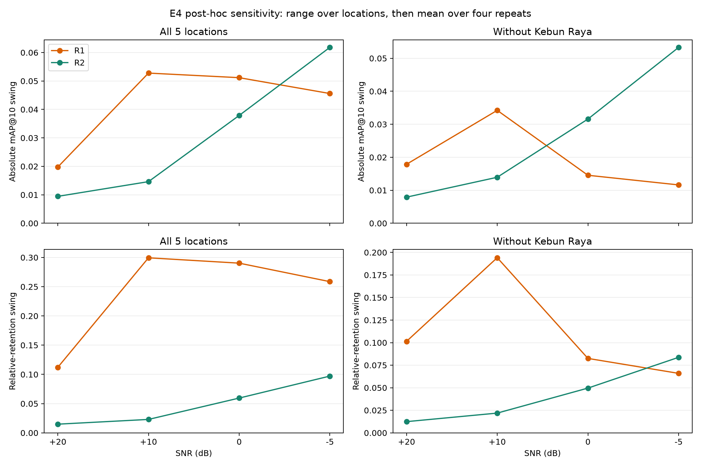

# Noise and Spectral Sensitivity of Frozen Audio Representations for Bioacoustic Similarity Retrieval under Controlled ITERA Field-Noise Mixtures in Indonesian Avifauna

**Draf naskah Fabio Banyu Cyto — revisi 15 Oktober 2026**

Penelitian mengevaluasi representasi audio beku untuk similarity retrieval ketika query burung Xeno-Canto Indonesia dicampur dengan noise lapangan AudioMoth ITERA. Hasil membandingkan ketahanan ranking, penerimaan query pada threshold beku, dan sensitivitas terhadap profil noise lima lokasi.

Landasan teori dan tinjauan pustaka yang ditulis ulang tersedia pada [Teori Dasar](teori_dasar.md). Naskah tersebut mengoreksi Bagian 2.8, formula gap E4−E2, Gambar 6, jumlah gallery, Gambar 8, serta enam konfigurasi AudioMoth pada Bagian 3.6. Draf dosen di folder Teori Dasar dipertahankan sebagai rujukan.

## Pertanyaan penelitian aktif

1. Representasi mana yang mempertahankan retrieval terbaik ketika SNR query menurun?
2. Bagaimana recall penerimaan known dan false-accept rate unknown berubah ketika threshold calibration-clean dibekukan?
3. Bagaimana ayunan mAP@10 absolut dan retensi relatif R1/R2 berubah pada lima lokasi, serta ketika Kebun Raya dikeluarkan sebagai analisis sensitivitas?
4. Moda kegagalan dan hubungan margin serta fitur akustik apa yang dapat diamati dari keluaran yang tersedia?

Rumusan aktif mengikuti amendemen 12 Oktober setelah hasil tersedia. Reformulasi H3 dan interpretasi H4 bersifat eksploratif. [RQ dan riwayatnya](../docs/research/rq.md) serta [rumusan hipotesis asli](../docs/research/hypotheses.md) mencatat bentuk 6 September dan tanggal perubahannya; H3 asli tentang real-soundscape belum diuji.

## Metode E4 yang dipertahankan

E4 mencakup 311 query × lima lokasi × empat SNR × empat ulangan untuk setiap representasi. Lokasinya Kebun Raya, Embung F, Gedung F, Masjid At-Tanwir, dan sekitar GKU 1. Gallery tetap berisi 673 rekaman. Kategori AudioMoth per query dipasangkan lintas kondisi; ulangan mengubah pemilihan segmen noise.

Revisi ini membaca CSV E4 tersimpan dan tidak mengulang mixing atau inferensi. Analisis sensitivitas tidak menghapus Kebun Raya dari eksperimen. Selisih skor E4−E2 tidak digunakan untuk mengisolasi domain shift di luar noise aditif karena E2 dan E4 sama-sama menggunakan additive mixture.

## Hasil H3 untuk Bab 4

Ayunan lokasi dihitung per ulangan, kemudian dirata-ratakan empat kali. Ayunan relatif membagi ayunan absolut dengan mAP@10 clean masing-masing representasi. Baseline clean R1 = 0,176268 dan R2 = 0,636709, sehingga perbedaan normalisasi dapat mengubah urutan perbandingan.

| Subset dan ukuran, rata-rata empat SNR | R1 | R2 | R1−R2 | CI 95% selisih |
|---|---:|---:|---:|---|
| Lima lokasi, absolut | 0,042324 | 0,030949 | 0,011375 | [−0,003993; 0,022140] |
| Lima lokasi, relatif | 0,240111 | 0,048607 | 0,191504 | [0,152203; 0,241969] |
| Tanpa Kebun Raya, absolut | 0,019567 | 0,026686 | −0,007119 | [−0,018009; 0,003056] |
| Tanpa Kebun Raya, relatif | 0,111009 | 0,041912 | 0,069097 | [0,048683; 0,121152] |

Rata-rata ayunan absolut belum menunjukkan perbedaan yang meyakinkan pada kedua subset. Selisih ayunan relatif rata-rata mengecil sekitar 63,9% setelah Kebun Raya dikeluarkan, tetapi tetap positif. Angka penurunan tersebut adalah perbandingan deskriptif, bukan estimasi kontribusi kausal Kebun Raya.

Pada −5 dB, lima lokasi menghasilkan ayunan absolut R1 = 0,045596 dan R2 = 0,061829. Tanpa Kebun Raya, ayunan relatif R1 = 0,065937 dan R2 = 0,083724; selisih −0,017787, CI [−0,041711; 0,050057]. Dengan demikian, keunggulan R2 tidak dinyatakan sebagai ayunan lebih sempit pada semua metrik, SNR, dan subset.

*Analisis eksploratif 15 Oktober dari CSV E4 asli. Kurva menampilkan point estimate; CI berpasangan seluruh kondisi tersedia pada tabel sensitivitas. Empat ulangan dan 311 query dipertahankan.*

## Hasil H4 dan batas kesimpulan

Threshold E3 tidak berubah. Recall penerimaan known R2 turun dari 0,604502 pada clean menjadi 0,254019 pada −5 dB; false-accept rate turun dari 0,222581 menjadi 0,129032. Penurunan recall sesuai salah satu klausul H4 asli. Kenaikan false accept dan mekanisme kompresi skor sebagai penyebab tidak dinyatakan terbukti.

CI H3 diperoleh dari 10.000 resampling query berpasangan, seed 20261012. Inferensi kondisional pada lokasi dan segmen noise yang sudah tersedia; ia bukan ketidakpastian terhadap lokasi/sesi lapangan baru. Dugaan biofoni serangga atau distorsi frekuensi perlu pengujian fitur spektral segmen noise sebelum menjadi kesimpulan mekanistik.

## Sumber hasil

- [Registri eksperimen](../experiments/experiment_registry.csv).
- [Ringkasan E0–E5](../docs/RESULTS_RQ_HYPOTHESES_2026-10-12.md), dengan koreksi pelaporan 15 Oktober.
- [Hasil sensitivitas H3](../results/reproductions/H3_sensitivity_20261015/tables/h3_swing_summary.csv) dan [provenance](../results/reproductions/H3_sensitivity_20261015/metadata.json).
- [Matriks RQ/H revisi](../results/tables/28_rq_hypothesis_matrix_revised_2026-10-15.csv).
- [Catatan revisi untuk bimbingan](../docs/REVISION_SUPERVISOR_2026-10-15.md).
