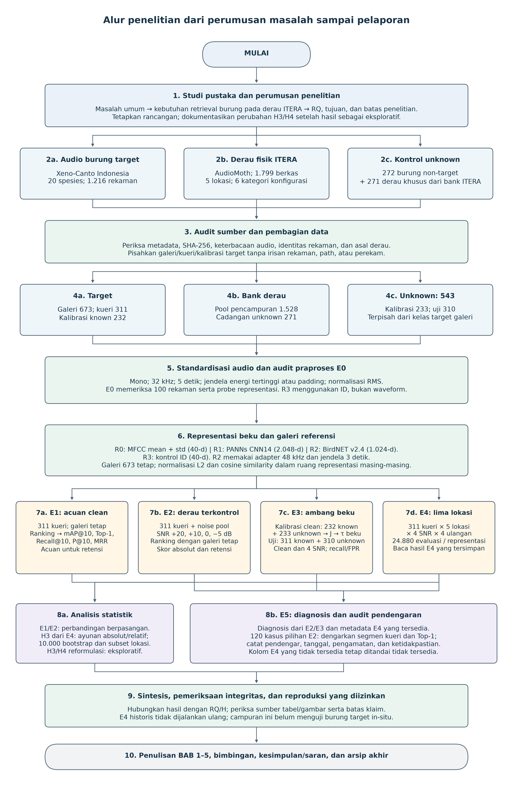

# Bahan penulisan BAB 1–3

**Pemeriksaan folder lokal: 30 Oktober 2026.** Paket ini menunjukkan bahan yang sudah ada dan menambah satu diagram alir lengkap yang belum tersedia dalam versi protokol aktif. Tabel penelitian, gambar lama, naskah teori, dan template bab tidak dibuat ulang atau diubah.

## 1. Yang ditemukan dan yang baru disiapkan

**Sudah ada:** naskah teori; tabel referensi CSV/Excel; manifes dan tabel data; tabel variabel serta representasi dalam Markdown; gambar waveform/spektrogram; diagram hubungan E2–E4; ilustrasi cosine; dan template LaTeX BAB 1–3.

**Belum ada dalam versi lengkap dan sesuai protokol aktif:** diagram alir yang mencakup perumusan masalah, sumber dan pembagian data, E0–E5, kalibrasi terpisah, analisis, audit manusia, serta pelaporan. Diagram Mermaid pada panduan sehari-hari baru menggambarkan alur retrieval ringkas. Diagram pada draf lama masih membawa beberapa angka/desain historis.

Karena itu dibuat **satu diagram baru**, tersedia sebagai:

- [PNG 300 dpi untuk dimasukkan ke Word](gambar/alur_penelitian_lengkap.png).
- [SVG vektor untuk diperbesar tanpa pecah](gambar/alur_penelitian_lengkap.svg).
- [Sumber Mermaid yang dapat diedit](gambar/alur_penelitian_lengkap.mmd).
- [Metadata sumber dan hash](gambar/metadata_diagram.json); [pembuat gambar](gambar/buat_diagram.py).

Ketiga format visual/sumber tersebut menggambarkan diagram yang sama. Ini bukan tiga diagram atau eksperimen baru.

**Usulan penempatan:** BAB 3, subbab Tahapan Penelitian. Nomor gambar mengikuti urutan gambar dalam naskah final, jadi tidak dibekukan menjadi Gambar 3.1 di nama berkas.

**Usulan keterangan:** “Diagram alir penelitian evaluasi ketahanan representasi audio beku untuk retrieval burung Indonesia dengan pencampuran derau ITERA. Alur mencakup pembagian data, E0–E5, kalibrasi ambang terpisah, analisis berpasangan, dan pelaporan. R3 merupakan kontrol berbasis ID. E4 menggunakan hasil historis tersimpan dalam pekerjaan revisi. Sumber: disusun peneliti berdasarkan manifes, implementasi, dan identitas run aktif.”

Diagram memuat hubungan metode dan data, bukan instruksi menjalankan seluruh eksperimen lagi. Cabang E1–E4 memakai acuan galeri yang sama; kueri uji known E3 berasal dari kondisi clean/bising E2, sementara ambangnya dipilih hanya dari calibration-clean. Sebanyak 271 derau unknown merupakan bagian dari bank 1.799 berkas, bukan tambahan di luar bank. Diagram tidak menyatakan semua bab sudah ditulis/disetujui. Penulisan dan bimbingan adalah tahap berikutnya.

Gambar cukup padat karena mencakup penelitian dari awal sampai akhir. Simpan SVG sebagai sumber utama; saat masuk naskah, gunakan satu halaman penuh dan periksa keterbacaan pada ukuran cetak sesuai pedoman kampus. Teks di setiap kotak telah diperiksa agar tidak melampaui batas gambar.

## 2. Gambar yang sudah ada: gunakan sesuai fungsi

Tautan di bawah menunjuk sumber yang sudah ada; tidak ada penyalinan atau penggambaran ulang.

| Bahan | Berkas yang sudah ada | Tempat yang sesuai dan status |
|---|---|---|
| Contoh waveform dan spektrogram burung | [03_eda_bird_waveform_spectrogram_examples.png](../../results/figures/03_eda_bird_waveform_spectrogram_examples.png) | BAB 2 untuk menjelaskan representasi waktu–frekuensi; BAB 3 untuk contoh data. Gambar memakai contoh fisik yang tercatat. |
| Contoh spektrogram derau lima lokasi | [05_eda_itera_noise_spectrogram_profiles.png](../../results/figures/05_eda_itera_noise_spectrogram_profiles.png) | BAB 3 untuk memperkenalkan sumber derau. Ini contoh segmen, bukan bukti sebab kausal perbedaan performa. |
| Hubungan rancangan E2 dan E4 | [fig06_e4_noise_profiles.png](../figures/revision_20261015/fig06_e4_noise_profiles.png) | BAB 3 untuk menjelaskan campuran terkontrol dan lima lokasi. Sudah mengikuti korpus aktif; tidak perlu dibuat ulang. |
| Ilustrasi cosine pada vektor ternormalisasi | [fig07_cosine_unit_sphere.png](../../Teori%20Dasar/figures/fig07_cosine_unit_sphere.png) | BAB 2, sebagai ilustrasi konseptual. Berasal dari draf pembimbing dan tersedia lokal; beri atribusi sesuai sumber, bukan klaim data eksperimen. |
| Rantai MFCC | [fig01_rantai_mfcc.png](../../Teori%20Dasar/figures/fig01_rantai_mfcc.png) | Ilustrasi sinyal sintetis, bukan rekaman burung. Panel menyebut 64 filter Mel; jangan menyalinnya sebagai parameter implementasi aktif. Lihat catatan §5. Tidak digambar ulang. |
| Batas Recall@10 korpus aktif | [fig08_recall_ceiling_active.png](../figures/revision_20261015/fig08_recall_ceiling_active.png) | Sudah ada. Gabungan teori dan hasil E1; lebih cocok BAB 4/pembahasan. Untuk BAB 2 cukup jelaskan rumus batasnya tanpa menyajikan hasil sebagai teori. |
| Distribusi spesies | [07_eda_species_distribution.png](../../results/figures/07_eda_species_distribution.png) | Sudah ada. Bila dipakai BAB 3, jelaskan sebagai deskripsi data; tabel 20 spesies biasanya lebih hemat ruang. |
| Jumlah rekaman derau menurut lokasi | [06_eda_noise_locations.png](../../results/figures/06_eda_noise_locations.png) | Sudah ada. Cakupannya pool pencampuran 1.528 berkas; bukan total bank 1.799. |

**Catatan akses diperbarui 1 November 2026:** folder `Teori Dasar/`, sumber dan ekspor LaTeX, paket belajar, serta pembaruan pustaka disertakan dalam sinkronisasi repositori. [Bahan teori lama](../../Teori%20Dasar/README.md) tetap bertanda historis; keterlacakan berkas tidak menjadikan angka atau klaim lamanya berlaku kembali. Audio, checkpoint, dan cache tetap lokal.

## 3. Gambar lama yang perlu dibedakan dari bahan aktif

| Berkas lama | Mengapa tidak langsung dimasukkan ke naskah |
|---|---|
| [fig02_pipeline_retrieval.png](../../Teori%20Dasar/figures/fig02_pipeline_retrieval.png) | Masih menuliskan galeri 3.653; galeri aktif 673. Diagram lengkap baru di atas memakai jumlah aktif dan membedakan R3. |
| [fig03_paired_noise_snr.png](../../Teori%20Dasar/figures/fig03_paired_noise_snr.png) | Masih menuliskan BirdCLEF+ dan 200 kueri. Rancangan aktif memakai Xeno-Canto Indonesia, 311 kueri. Hubungan E2/E4 sudah dijelaskan oleh gambar aktif yang tersedia. |
| [fig04_kurva_degradasi_hipotetis.png](../../Teori%20Dasar/figures/fig04_kurva_degradasi_hipotetis.png) | Kurva hipotetis. Untuk BAB 4, gunakan [grafik E2 aktual](../../results/figures/08_e2_snr_robustness_map10.png) yang sudah tersedia. |
| [fig05_open_set_threshold.png](../../Teori%20Dasar/figures/fig05_open_set_threshold.png) | Distribusi sintetis dan ambang lama 0,7128. Bukan hasil E3 aktif. Jelaskan prosedur secara konseptual di BAB 2–3; nilai hasil E3 dirujuk dari tabel aktif. |
| [fig06_focal_vs_soundscape.png](../../Teori%20Dasar/figures/fig06_focal_vs_soundscape.png) | Tidak menggambarkan E4 aktif yang berupa campuran aditif. Gunakan fig06 revisi yang ditunjukkan pada §2. |
| [fig08_recall_ceiling.png](../../Teori%20Dasar/figures/fig08_recall_ceiling.png) | Gunakan versi revisi `paper/figures/revision_20261015/fig08_recall_ceiling_active.png` untuk korpus aktif. |
| Diagram teks pada [Panduan_Komprehensif_Tugas_Akhir.md](../../Teori%20Dasar/Panduan_Komprehensif_Tugas_Akhir.md) | Memuat ambang R2 lama 0,7071 dan beberapa status lama. Rujukan konsep saja; tidak menjadi sumber angka aktif. |

Berkas historis tersebut dipertahankan. Tidak ada perubahan pada draf pembimbing atau gambar aslinya dalam persiapan ini.

## 4. Tabel yang sudah ada: cukup buka dan pilih kolom yang dibutuhkan

Daftar berikut adalah **indeks lokasi**, bukan pembuatan ulang tabel penelitian. Nomor tabel akhir mengikuti urutan naskah.

| Kebutuhan BAB | Tabel/sumber yang sudah tersedia | Cara memakai |
|---|---|---|
| BAB 2: penelitian terdahulu | [referensi_jurnal_modern.xlsx](../bibliography/referensi_jurnal_modern.xlsx) atau [CSV yang sama](../bibliography/referensi_jurnal_modern.csv) | Versi lokal memuat 28 referensi. Pilih judul/penulis/tahun, data, metode, hasil, dan relevansi. Jangan memindahkan seluruh kolom audit ke skripsi. Jenisnya mencakup jurnal/prosiding/preprint. |
| BAB 2–3: jenis representasi | [tabel R0–R3 pada panduan teori sederhana](../../learning/PAKET_BELAJAR_UJIAN/02_TEORI_DAN_ALUR_METODE.md) | Tabel Markdown sudah ada: fitur klasik, audio generik, bioakustik, dan kontrol ID; dimensi serta alasan pembanding. |
| BAB 3: variabel dan rancangan E0–E5 | [tabel variabel dan eksperimen](../../learning/PAKET_BELAJAR_UJIAN/01_PENELITIAN_DAN_RANCANGAN.md) | Tabel Markdown sudah tersedia; gunakan bagian variabel dan fungsi eksperimen sebagai bahan metode, bukan sebagai persetujuan RQ resmi. |
| BAB 3: daftar 20 spesies dan jumlah rekaman | [05_eda_target_species_summary.csv](../../results/tables/05_eda_target_species_summary.csv) | Memuat 20 baris spesies, nama ilmiah/umum, rekaman, perekam, dan rating median. |
| BAB 3: pembagian target | [dataset_split.csv](../../data/manifests/dataset_split.csv) dan uraian [README bagian 6](../../README.md) | Manifes 1.216 baris adalah sumber pembagian galeri 673, kueri 311, dan kalibrasi 232. Tidak perlu menaruh semua 1.216 baris dalam bab. |
| BAB 3: data unknown | [unknown_open_set_manifest.csv](../../data/manifests/unknown_open_set_manifest.csv) | Ada 543 baris kontrol, 233 kalibrasi dan 310 uji; kategori burung non-target/derau tercatat. |
| BAB 3: ringkasan sumber data dan partisi | [04_eda_summary_by_source.csv](../../results/tables/04_eda_summary_by_source.csv) | Sudah memuat peran dan jumlah sumber serta ringkasan durasi. Pilih baris yang sesuai korpus aktif. |
| BAB 3: bank derau dan identitas berkas | [itera_noise_manifest.csv](../../data/manifests/itera_noise_manifest.csv) | Sumber lengkap 1.799 berkas beserta hash. Metadata `verified_bird_free` bukan pengganti audit independen seluruh berkas. |
| BAB 3: distribusi derau pool pencampuran | [09_eda_noise_locations.csv](../../results/tables/09_eda_noise_locations.csv) | Ada 10 baris lokasi × metode, total 1.528 berkas. Ini belum dipecah menurut seluruh enam konfigurasi; jangan menyebut tabel ini mencakup total bank 1.799. Tabel 06 berisi ringkasan yang sama, sehingga cukup pilih satu. |
| BAB 3: enam kategori konfigurasi AudioMoth | [tabel metode–level pada teori dasar §3.6](../teori_dasar.md) dan [protokol rekaman](../../docs/protocols/itera-recording.md) | Tabel sudah ada dalam Markdown. Enam kategori adalah kombinasi metode × level; bukan bukti jumlah enam perangkat. |
| BAB 3: metrik dan rumus | [teori dasar §2.4–2.7](../teori_dasar.md), [contoh perhitungan](../../learning/PAKET_BELAJAR_UJIAN/03_PERHITUNGAN_LANGKAH_DEMI_LANGKAH.md) | Definisi/formula sudah ada. Rumus AP, Recall, dan penerimaan harus mengikuti implementasi aktif. |
| BAB 2/pembahasan: batas Recall@10 per spesies | [recall10_ceiling_by_species.csv](../figures/revision_20261015/recall10_ceiling_by_species.csv) | Sudah tersedia 20 baris: jumlah galeri, jumlah kueri, dan ceiling. Hasil E1 diletakkan pada BAB 4. |
| BAB 3: perangkat lunak/lingkungan | [environment.json](../../results/reproductions/RECHECK_FRESH_20261016/environment.json), [versi dependensi](../../results/reproductions/RECHECK_FRESH_20261016/requirements-resolved.txt) | Data lingkungan sudah ada. Ini tidak otomatis menyediakan spesifikasi CPU/RAM atau seluruh alat lapangan; tulis hanya spesifikasi yang dapat dibuktikan. |
| BAB 3: prosedur audit manusia; BAB 4: catatannya | [lembar sumber](../../Rencana-eksperimen-bimbingan/audit-pendengaran-E5/E5_AUDIT_PENDENGARAN.csv), [CSV audit terisi](../../Rencana-eksperimen-bimbingan/audit-pendengaran-E5/E5_HASIL_ULASAN_2026-10-30.csv), [laporan 30 Oktober](../../Rencana-eksperimen-bimbingan/audit-pendengaran-E5/hasil-20261030/README.md) | Ada 120 kasus dan jejak koreksi E5_105. BAB 3 menjelaskan cara audit; angka hasil/temuan masuk BAB 4. |
| BAB 3: jadwal penelitian | [rencana kerja pada README bagian 12](../../README.md), [catatan progres bimbingan](../../Rencana-eksperimen-bimbingan/CATATAN_PROGRES_BIMBINGAN.md) | Sudah ada dalam Markdown. Jadwal yang benar-benar diajukan/berlaku perlu disesuaikan dengan persetujuan pembimbing; jadwal historis tidak disamarkan sebagai rencana baru. |

Tabel hasil E1–E5 juga sudah ada di [results/tables](../../results/tables/). Untuk **BAB 4**, gunakan 10 (E1), 11 (E2), 12–13 (E3), 14 (E4), 15–17 (E5), serta [H3 sensitivitas](../../results/reproductions/H3_sensitivity_20261015/tables/h3_swing_summary.csv) dan [penghilangan satu lokasi](../../results/reproductions/H3_leave_one_location_out_20261018/tables/h3_leave_one_location_out.csv). Daftar itu tidak perlu dibuat ulang sebagai spreadsheet baru.

Jangan memakai `07_eda_physical_audio_inventory.csv` yang berisi 3.396 baris sebagai jumlah korpus eksperimen aktif tanpa menelusuri peran setiap berkas. Itu inventaris fisik yang lebih luas. Jumlah target, unknown, dan pool derau harus bersumber dari manifes/pembagian yang sesuai; 271 derau unknown sudah termasuk bank 1.799.

## 5. Parameter: utamakan implementasi dan artefak run

Dokumen konfigurasi masih memiliki sebagian komentar/nilai historis. Persiapan ini **tidak mengubah konfigurasi**. Untuk menulis metode gunakan sumber berikut:

- Praproses: [src/preprocess.py](../../src/preprocess.py). Mono, 32 kHz, lima detik, langkah jendela 1,25 detik, RMS menuju 0,05, serta batas amplitudo.
- MFCC: [src/mfcc.py](../../src/mfcc.py). Kode memasok `n_mfcc=20`, `n_fft=1024`, dan `hop_length=512`, lalu mean/std menjadi 40 dimensi. Kode tidak memasok `n_mels=64`, `fmin=150`, atau `fmax=15000` dari YAML. Pada lingkungan lokal yang diperiksa, librosa 1.0.0 mempunyai default `n_mels=128`. Versi historis dicocokkan melalui bukti runtime; jangan menjadikan gambar berlabel 64 sebagai bukti implementasi.
- Representasi: [src/embeddings.py](../../src/embeddings.py). R1 2.048 dimensi; R2 1.024 dengan adapter 48 kHz, jendela tiga detik, langkah satu detik; R3 vektor ID 40 dimensi.
- Pencampuran: [src/mix_noise.py](../../src/mix_noise.py). Daya, skala alpha, segmen, penolakan derau senyap, dan pencatatan sumber.
- Retrieval: [src/retrieve.py](../../src/retrieve.py). Relevansi spesies, cosine, AP/mAP, Recall, P, Top-1, dan RR.
- Ambang: [src/calibrate_threshold.py](../../src/calibrate_threshold.py). Kandidat ROC empiris, Youden, kemudian ambang beku; jumlah pembagian dari manifes dan run E3.
- E4: [run_identity.json](../../results/reproductions/E4_5sites_20261011T213404_350219Z/run_identity.json). Lima lokasi, empat SNR, empat ulangan. Lihat [panduan sumber/cache E4](../../docs/protocols/e4-cache-reproduction.md).
- H3: [hypotheses.md](../../docs/research/hypotheses.md) dan skrip statistik sumber. H3 memakai 10.000 bootstrap; jangan menyalin `bootstrap_iterations: 1000` dari konfigurasi umum sebagai parameter H3 aktif.
- E5: [run_e5_diagnostics.py](../../scripts/run_e5_diagnostics.py) dan [laporan audit 30 Oktober](../../Rencana-eksperimen-bimbingan/audit-pendengaran-E5/hasil-20261030/README.md). Kasus pilihan aktif 120; bukan komentar lama 30 kasus pada konfigurasi.

## 6. Susunan bahan BAB 1–3

### BAB 1: Pendahuluan

Susun latar dari masalah umum pemantauan lingkungan dan banyaknya rekaman, lalu masalah khusus pencarian suara burung ketika kueri bising. Hubungkan dengan tujuan evaluasi, ruang lingkup, manfaat, dan kontribusi protokol. Bahan sudah tersedia pada [research-charter](../../docs/research/research-charter.md), [batas kebaruan](../../docs/research/novelty-boundary.md), dan [panduan bahasa sederhana](../../learning/PAKET_BELAJAR_UJIAN/01_PENELITIAN_DAN_RANCANGAN.md).

BAB 1 tidak wajib dipenuhi gambar atau tabel. Jika memakai angka konteks umum biodiversitas atau kebijakan terbaru, verifikasi sumber primer ketika menulis. Angka penelitian sendiri tidak menggantikan sumber untuk klaim ekologis umum. Hindari klaim “pertama di dunia” atau manfaat konservasi yang belum diukur.

### BAB 2: Tinjauan pustaka dan teori dasar

Urutan bahan yang masuk akal: penelitian terdahulu; audio digital dan spektrum; MFCC; representasi frozen PANNs/BirdNET; cosine dan retrieval; AP/mAP/Recall; SNR dan pencampuran; open-set/Youden; domain shift beserta batas E4; serta evaluasi berpasangan dan bootstrap. Sumber teks utama yang sudah ada: [paper/teori_dasar.md](../teori_dasar.md). Ilustrasi teori dipilih dari §2–3 paket ini sesuai statusnya.

Tabel literatur tidak otomatis menjadi uraian skripsi yang final. Pilih artikel paling dekat, baca bagian yang dikutip, bedakan klasifikasi/deteksi/retrieval, dan pertahankan versi publikasi. Dua PDF pustaka masih belum diperoleh; status lengkap ada pada [pemeriksaan referensi 27 Oktober](../bibliography/PEMERIKSAAN_REFERENSI_2026-10-27.md).

### BAB 3: Metodologi

Urutan bahan: desain evaluasi dan batas; sumber data dan kriteria; unit kueri/galeri/kalibrasi; pemisahan data; lingkungan implementasi; diagram alir; praproses; representasi dan galeri tetap; E1/E2; kalibrasi dan transfer E3; E4 lima lokasi; E5 dan audit manusia; metrik; statistik; integritas dan reproduksi.

Gunakan diagram baru sebagai gambar utama Tahapan Penelitian, kemudian gambar E2/E4 yang sudah ada hanya bila perlu memperjelas rancangan tersebut. Caption menjelaskan fungsi gambar; jangan menuliskan hasil performa sebagai parameter desain. H3/H4 yang direformulasi harus tetap disebut eksploratif beserta riwayat perubahan. Galeri bersih, ambang kalibrasi terpisah, dan kontrol ID harus jelas pada teks metode.

## 7. Yang perlu dikonfirmasi sebelum menjadi bab resmi

- Judul dan rumusan masalah final, termasuk usulan bahasa “bagaimana”, mengikuti persetujuan pembimbing. RQ resmi lama belum diubah oleh paket ini.
- Persetujuan mulai menulis BAB 1–3, sistematika kampus, gaya sitasi, serta penempatan gambar/tabel.
- Spesifikasi alat/hardware yang tidak tercatat, bila diwajibkan. Peta/foto lokasi bukan gambar yang boleh direka dari nama lokasi; gunakan foto atau koordinat terverifikasi jika nanti diperlukan.
- Pemakaian gambar dari draf pembimbing mengikuti atribusi dan penyesuaian yang disepakati. Gambar berparameter lama tidak dipakai sebagai hasil aktif.

Pembaruan penulisan sampai 31 Oktober sudah mengisi [BAB 1](../template_ta_latex/chapters/bab1.tex): Latar Belakang, Rumusan Masalah, Tujuan, dan Batasan Penelitian. [BAB 2](../template_ta_latex/chapters/bab2.tex) dan [BAB 3](../template_ta_latex/chapters/bab3.tex) masih kerangka berkomentar/kosong. [Status template dan ekspor PDF](../template_ta_latex/README.md) menjelaskan hasil penulisan terbaru. Paket persiapan ini tetap bahan bantu, bukan pengesahan bab.

## 8. Catatan perubahan paket ini

Hanya folder baru `paper/persiapan_bab1_3/` yang dibuat: indeks bahan ini; satu diagram lengkap dalam PNG/SVG; sumber Mermaid; pembuat gambar; serta metadata hash. Tidak ada tabel CSV/Excel baru. Semua tautan lokal diperiksa keberadaannya. Parameter dan jumlah pada diagram ditelusuri ke kode/manifes; teks di dalam kotak serta tampilan gambar diperiksa. Tidak ada audio atau eksperimen yang dijalankan.
