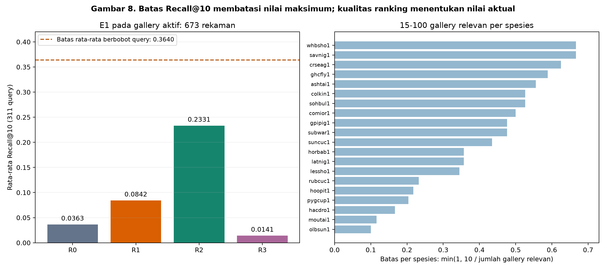
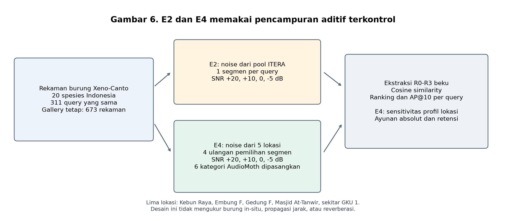

# Teori Dasar dan Tinjauan Pustaka DSIC-2706

**Naskah Fabio Banyu Cyto — penyesuaian 15 Oktober 2026**

Penelitian ini membandingkan representasi audio beku untuk mencari rekaman burung yang relevan terhadap sebuah contoh suara. Fokus pengujiannya adalah perubahan kualitas ranking ketika rekaman burung Indonesia dicampur dengan derau lapangan ITERA pada SNR terkontrol. Uji lintas lokasi memperluas variasi sumber derau, sedangkan uji open-set memeriksa keputusan menerima atau menolak query. Ketiganya memberikan informasi berbeda tentang kegunaan representasi.

Naskah ini mengikuti korpus aktif Xeno-Canto Indonesia: **1.216 rekaman dari 20 spesies**, dengan **673 gallery, 311 query, dan 232 calibration**. Angka pada draf rujukan dosen yang berasal dari rezim BirdCLEF lama tidak digunakan untuk menjelaskan eksperimen aktif. Draf dosen tetap dipertahankan sebagai rujukan, sedangkan uraian dan gambar berikut disusun untuk naskah penelitian ini.

## 2. Teori Dasar

### 2.1 Audio digital dan standardisasi masukan

Audio digital berupa sampel amplitudo x[n] pada laju sampel tertentu. Perbandingan audio memerlukan penyeragaman kanal, laju sampel, dan panjang masukan agar perbedaan format tidak mendominasi perhitungan fitur. Pada pipeline penelitian, audio diubah menjadi mono, di-resample ke 32 kHz, dan disiapkan sebagai segmen lima detik atau 160.000 sampel.

Jika rekaman lebih panjang, kandidat jendela digeser setiap 1,25 detik dan dipilih menurut RMS tertinggi. Rekaman yang lebih pendek diberi zero-padding. Energi kemudian dinormalisasi menuju RMS 0,05 dan amplitudo dibatasi ke rentang [−1,1]. RMS dihitung sebagai

$$
\operatorname{RMS}(x)=\sqrt{\frac{1}{N}\sum_{n=0}^{N-1}x[n]^2}.
$$

Jendela paling berenergi merupakan heuristik untuk memilih bagian aktif, bukan anotasi vokalisasi burung. Gangguan non-burung yang keras juga dapat terpilih. Pembatasan amplitudo dapat membuat RMS akhir berbeda dari target; oleh sebab itu mixer memakai daya sinyal yang benar-benar dihasilkan, bukan menganggap semua query tepat berdaya 0,0025. Istilah clean berarti belum ditambah noise eksperimen, bukan tanpa latar akustik.

### 2.2 MFCC sebagai baseline akustik

MFCC merangkum bentuk spektral suara melalui analisis bingkai pendek, pemetaan energi ke skala mel, transformasi log, dan transformasi kosinus. Analisis bingkai mempertahankan informasi perubahan frekuensi terhadap waktu sebelum hasilnya diringkas menjadi vektor.

R0 mengikuti implementasi aktif pada src/mfcc.py: 20 koefisien MFCC, FFT 1.024 sampel, dan hop 512 sampel. Rata-rata serta simpangan baku setiap koefisien digabungkan:

$$
\mathbf e_{R0}
=[\mu(c_0),\ldots,\mu(c_{19}),\sigma(c_0),\ldots,\sigma(c_{19})]\in\mathbb R^{40}.
$$

Pooling tersebut menghasilkan panjang fitur yang tetap, tetapi menghilangkan urutan temporal bingkai. Skor tinggi dapat berasal dari kemiripan campuran panggilan dan latar. MFCC tidak secara langsung menghitung jumlah panggilan atau memastikan kemiripan identitas spesies. Parameter mel yang tidak dipasok secara eksplisit oleh fungsi mengikuti versi librosa yang digunakan; angka konfigurasi yang tidak dibaca kode tidak diklaim sebagai parameter implementasi.

### 2.3 Representasi pralatih dalam keadaan beku

Model pralatih dapat digunakan sebagai pemetaan audio ke embedding tanpa memperbarui bobotnya. Pendekatan ini mengurangi kebutuhan melatih model baru dari data target, tetapi kualitasnya tetap bergantung pada domain dan tugas yang dipelajari saat pralatih.

PANNs dikembangkan untuk representasi audio umum berbasis AudioSet (Kong et al., 2020). Pada R1, checkpoint CNN14 lokal menghasilkan embedding 2.048 dimensi. BirdNET merupakan sistem pengenalan suara burung yang menjadi landasan penggunaan model khusus bioakustik (Kahl et al., 2021). R2 memakai checkpoint lokal BirdNET V2.4 ONNX untuk embedding 1.024 dimensi; artikel BirdNET tersebut adalah rujukan sistem dasar, bukan bukti bahwa seluruh detail versi V2.4 identik dengan versi publikasi 2021.

Dalam implementasi R2, segmen lima detik di-resample ke 48 kHz. Jendela tiga detik dengan langkah satu detik menghasilkan embedding yang kemudian dirata-ratakan dan dinormalisasi. R1 dan R2 sama-sama menerima konten query yang telah distandardisasi, dengan penyesuaian masukan yang diperlukan model masing-masing.

Ghani et al. (2023) menunjukkan kegunaan embedding model burung untuk transfer ke tugas bioakustik lain. Temuan tersebut menjadi alasan membandingkan representasi khusus burung dengan audio umum, tetapi tidak menggantikan evaluasi ketahanan derau pada korpus penelitian ini.

R3 adalah kontrol acak 40 dimensi dari distribusi normal standar yang ditentukan oleh hash ID rekaman dan seed 42, lalu dinormalisasi L2. R3 tidak membaca perubahan waveform. Nilai yang tetap antara clean dan noisy merupakan sifat kontrol, sehingga retensinya tidak ditafsirkan sebagai ketahanan akustik.

### 2.4 Cosine similarity dan pencarian gallery

Embedding dinormalisasi ke norma L2 satu. Kemiripan query q dan rekaman gallery g dihitung sebagai

$$
s(q,g)=\frac{\mathbf e_q^\top\mathbf e_g}{\|\mathbf e_q\|_2\|\mathbf e_g\|_2}.
$$

Gallery diurutkan dari skor terbesar ke terkecil. Label spesies dipakai setelah pengurutan untuk menilai relevansi, bukan untuk membentuk skor kemiripan. Skor cosine juga bukan probabilitas bahwa dua rekaman memiliki spesies yang sama.

Gallery aktif berisi **673 rekaman**, sehingga seluruh skor query terhadap gallery dapat dihitung langsung. Jumlah relevan untuk satu query berbeda menurut spesies, yaitu 15–100 rekaman. Jumlah ini penting ketika menginterpretasikan Recall@10.

### 2.5 Metrik retrieval dan batas Recall@10

Misalkan rel_i bernilai satu jika hasil peringkat i berspesies sama dengan query dan R_q adalah banyaknya rekaman relevan di seluruh gallery. Precision@k menghitung proporsi hasil relevan di k teratas, sedangkan Recall@k menghitung bagian dari seluruh rekaman relevan yang berhasil ditemukan:

$$
P@k=\frac{\sum_{i=1}^{k}\mathrm{rel}_i}{k},
\qquad
R@k=\frac{\sum_{i=1}^{k}\mathrm{rel}_i}{R_q}.
$$

Implementasi membatasi k pada ukuran gallery bila diperlukan. AP@k juga mempertimbangkan letak hasil relevan:

$$
AP@k(q)=\frac{\sum_{i=1}^{k}P@i\,\mathrm{rel}_i}{\min(R_q,k)},
\qquad
mAP@k=\frac1{|\mathcal Q|}\sum_{q\in\mathcal Q}AP@k(q).
$$

Top-1 memeriksa relevansi peringkat pertama. MRR menggunakan kebalikan peringkat hasil relevan pertama. Metrik primer penelitian tetap mAP@10; revisi penjelasan ini tidak mengubah ranking atau metrik eksperimen.

Karena hanya sepuluh hasil yang diperiksa,

$$
R@10(q)\leq c_q=\min(1,10/R_q).
$$

Pada gallery aktif, batas per spesies adalah **0,1000–0,6667**, bukan rentang 0,038–0,080 dari gallery lama 3.653 klip. Batas untuk rata-rata atas 311 query harus dibobotkan menurut jumlah query setiap spesies:

$$
\overline c_{\mathrm{query}}
=\frac1{311}\sum_{q=1}^{311}c_q
=0,363997.
$$

Rata-rata tak berbobot atas 20 spesies adalah 0,406900 dan menjawab pertanyaan agregasi yang berbeda. Rata-rata Recall@10 E1 adalah R0 = 0,036321; R1 = 0,084175; R2 = 0,233109; dan R3 = 0,014092.

*Gambar 8. Nilai E1 dari tabel hasil aktif dibandingkan dengan batas teoritis rata-rata berbobot query. Panel kanan menunjukkan batas per spesies dari manifes gallery. Batas k/R_q membatasi nilai maksimum, sedangkan ranking menentukan nilai yang dicapai. Sumber dan checksum dicatat dalam metadata gambar.*

Batas tersebut tidak membuktikan bahwa metrik telah mencapai ceiling dan tidak menghapus perbedaan kualitas representasi. Pembagian rata-rata recall oleh rata-rata ceiling juga tidak sama dengan rata-rata recall ternormalisasi per query; metrik baru itu tidak ditambahkan diam-diam pada hasil E1.

### 2.6 Pencampuran derau pada SNR terkontrol

Daya sinyal dihitung dari rata-rata kuadrat amplitudo. Untuk query Q dan segmen noise N, faktor pencampuran α dipilih agar rasio daya sesuai dengan SNR target:

$$
P_x=\frac1N\sum_n x[n]^2,
\qquad
\alpha=\sqrt{\frac{P_Q}{P_N\,10^{\mathrm{SNR}/10}}},
\qquad y=Q+\alpha N.
$$

Jika campuran melewati rentang amplitudo yang ditetapkan, satu faktor gain diterapkan pada keseluruhan campuran. Penskalaan bersama komponen sinyal dan noise mempertahankan rasio daya. Metadata mixing menyimpan SNR target, SNR aktual, path noise, posisi segmen, dan seed agar pencampuran dapat ditelusuri.

E2 membandingkan clean dan SNR +20, +10, 0, −5 dB untuk query yang sama. Segmen noise per query bersifat deterministik dan dipasangkan lintas SNR serta representasi. Desain pencampuran seperti ini sejalan dengan penggunaan SNR sebagai parameter sintesis pada Scaper (Salamon et al., 2017), tanpa menyamakan campuran terkontrol dengan seluruh proses perekaman alami.

Penurunan absolut dan retensi relatif dilaporkan bersama:

$$
D_m(s)=C_m-A_m(s),
\qquad
\rho_m(s)=A_m(s)/C_m.
$$

Retensi bergantung pada baseline clean C_m. Oleh karena itu perbandingan perubahan relatif perlu didampingi nilai mAP@10 absolut.

### 2.7 Open-set dan threshold beku

Skor penerimaan query adalah kemiripan maksimum terhadap gallery:

$$
s_{\max}(q)=\max_{g\in\mathcal G}s(q,g),
\qquad
\mathrm{accept}(q)=\mathbb1[s_{\max}(q)\geq\tau].
$$

Threshold dipilih menggunakan Youden J pada calibration-clean yang terpisah, kemudian dibekukan. E3 memakai 232 known calibration dan 233 unknown calibration; pengujian memakai 311 known query dan 310 unknown test.

Known acceptance recall mengukur proporsi query known yang diterima, bukan proporsi query yang sekaligus mendapat spesies Top-1 benar. False-accept rate mengukur proporsi unknown yang diterima. Keduanya dapat turun bersama ketika distribusi skor berubah. Pada R2, recall penerimaan turun dari 0,604502 ke 0,254019 dan false-accept rate dari 0,222581 ke 0,129032 antara clean dan −5 dB.

Rumusan H4 dan penafsirannya diubah setelah hasil tersedia pada 12 Oktober 2026. Karena itu penafsiran hasil reformulasi diberi label eksploratif. Penurunan recall konsisten dengan salah satu klausul H4 asli, tetapi data tidak menunjukkan lonjakan false accept dan belum mengisolasi mekanisme kompresi skor sebagai penyebabnya.

### 2.8 Pergeseran domain dan batas interpretasi E4

Perpindahan dari rekaman fokal ke rekaman pasif dapat mengubah distribusi audio karena posisi sumber, jarak, respons perangkat, dan komposisi sumber suara berbeda. BIRB mengevaluasi retrieval dari rekaman fokal ke rekaman pasif, sedangkan BirdSet menyediakan evaluasi soundscape dengan label yang mendukung pengujian generalisasi (Hamer et al., 2023; Rauch et al., 2025).

E4 penelitian ini mempertahankan query fokal dan menambahkan noise dari **lima lokasi ITERA**. Variasi yang diuji adalah profil noise lokasi dalam pencampuran aditif. Galeri, query, kategori perangkat per query, dan tingkat SNR dipasangkan. Empat ulangan berasal dari empat pemilihan segmen noise, bukan empat rekaman burung baru.

*Gambar 6. E2 dan E4 sama-sama merupakan additive mixture. E4 mengondisikan lima lokasi dengan empat ulangan; desain ini belum menguji vokalisasi target in-situ atau mengisolasi propagasi jarak dan reverberasi. Diagram mengikuti run_identity.json E4.*

Dengan demikian, formula gap E4−E2 **tidak digunakan sebagai ukuran domain shift di luar derau aditif**. Kedua eksperimen menggunakan segmen noise dan pengondisian yang berbeda; selisih skornya tidak mengidentifikasi besaran kausal jarak, absorpsi, atau reverberasi.

Ukuran yang sesuai untuk pelaporan E4 adalah ayunan lintas lokasi. Definisikan A_m(s,r,l) sebagai mAP@10 pada representasi m, SNR s, ulangan r, dan lokasi l:

$$
S^{abs}_m(s)=\frac14\sum_{r=0}^{3}
\left[\max_l A_m(s,r,l)-\min_l A_m(s,r,l)\right],
\qquad
S^{rel}_m(s)=S^{abs}_m(s)/C_m.
$$

Rentang diambil dalam setiap ulangan sebelum dirata-ratakan. Kedua skala dapat memberikan urutan stabilitas berbeda karena baseline clean R1 dan R2 berbeda. Analisis lima lokasi dipertahankan; penghitungan tanpa Kebun Raya hanya merupakan sensitivitas yang diminta pembimbing.

Pada −5 dB, ayunan absolut lima lokasi adalah R1 = 0,045596 dan R2 = 0,061829. Tanpa Kebun Raya, ayunan relatif R1 = 0,065937 dan R2 = 0,083724 dengan CI selisih mencakup nol. Kalimat bahwa R2 selalu berayun lebih sempit tidak didukung sebagai kesimpulan lintas metrik dan subset. Dugaan peran biofoni serangga atau distorsi frekuensi belum diuji terhadap fitur spektral segmen noise dan tetap dinyatakan sebagai dugaan.

### 2.9 Pemisahan data dan keterlacakan

Gallery, query, dan calibration dipisahkan berdasarkan perekam secara global. Syaratnya adalah tidak ada irisan pada setiap pasangan himpunan perekam, bukan hanya irisan tiga himpunan sekaligus. Pemisahan ini mengurangi kemungkinan kesamaan perangkat atau gaya perekam menjadi petunjuk yang bocor antarketiga peran.

Hash manifes, checkpoint, kode, dan identitas rekaman menghubungkan hasil dengan masukan yang digunakan. Runner E4 asli dipertahankan pada path yang tercatat dalam run_identity.json, termasuk akhiran .py.draft, dengan SHA-256 yang sama. Cache embedding merupakan artefak turunan lokal; membangun cache baru tidak memberi izin mengganti checksum identitas run lama.

Independensi unknown terhadap sesi dan perekam belum sepenuhnya dibuktikan. Potensi overlap data pralatih BirdNET dengan Xeno-Canto juga tidak dihilangkan oleh split target. Keterbatasan tersebut membatasi generalisasi hasil.

### 2.10 Inferensi berpasangan dan analisis eksploratif

Bootstrap menggunakan query sebagai unit resampling. Pada satu iterasi, indeks query yang sama digunakan untuk kedua representasi dan seluruh lokasi, SNR, serta ulangan. Copy noisy dari satu query tidak diperlakukan sebagai observasi biologis independen.

Analisis sensitivitas H3 memakai 10.000 iterasi dengan seed 20261012. Pada setiap iterasi, mean AP@10 per kondisi dan baseline clean dihitung ulang; selanjutnya ayunan absolut, ayunan relatif, dan selisih R1−R2 dihitung. CI 95% memakai persentil 2,5 dan 97,5.

CI ini eksploratif dan kondisional pada lima lokasi serta segmen noise yang sudah tersedia. Ia tidak mengukur variasi terhadap lokasi baru, sesi baru, atau sampel perekam baru. Tidak ada klaim bahwa koreksi Holm, SESOI praregistrasi, atau uji mekanisme spektral baru telah dilakukan. Rumusan H3 asli dan perubahan H3/H4 setelah hasil dicatat pada [riwayat hipotesis](../docs/research/hypotheses.md).

## 3. Tinjauan Pustaka dan Kedudukan Data

### 3.1 Representasi audio umum dan khusus burung

PANNs menyediakan model pralatih AudioSet untuk beragam tugas audio (Kong et al., 2020). BirdNET dikembangkan pada domain burung (Kahl et al., 2021). Ghani et al. (2023) menunjukkan kegunaan embedding burung untuk transfer pada tugas bioakustik lain. Penelitian ini membandingkan dua sumber representasi tersebut dengan MFCC pada retrieval, tanpa menganggap keunggulan transfer pada satu tugas menjamin keunggulan ketahanan pada setiap kondisi noise.

### 3.2 Retrieval bioakustik

BIRB menggunakan retrieval vokalisasi burung dari data pasif sebagai masalah generalisasi (Hamer et al., 2023). Penelitian ini menggunakan relevansi spesies terhadap gallery tetap dan menghitung ranking cosine. Perbedaan tugas dan sumber data harus dipertahankan ketika membandingkan hasil, sehingga angka benchmark BIRB tidak dibandingkan langsung dengan mAP@10 korpus ini.

### 3.3 Derau terkontrol

Scaper menjadikan SNR bagian dari konstruksi campuran audio (Salamon et al., 2017). Dalam penelitian ini, sumber noise adalah rekaman lapangan ITERA, sedangkan tingkat pencampurannya ditetapkan secara matematis. Kehadiran noise nyata memberi variasi akustik terukur tanpa mengubah status desainnya menjadi evaluasi seluruh proses perekaman alami.

### 3.4 Generalisasi dari rekaman fokal ke soundscape

BIRB dan BirdSet memperlihatkan pentingnya evaluasi pada sumber rekaman yang berbeda. Evaluasi tersebut membutuhkan rekaman pasif yang memuat target dan label yang sesuai. Bank noise ITERA tidak menyediakan pengujian itu dalam E4 aktif. Klaim penelitian dibatasi pada sensitivitas profil noise lokasi, dan H3 asli tentang kesenjangan real-soundscape tidak dinyatakan sudah terjawab.

### 3.5 Penerimaan query di luar gallery

Open-set recognition membedakan masukan yang termasuk kelas dikenal dengan masukan di luar kelas dikenal. Vaze et al. (2022) memeriksa hubungan klasifikasi closed-set dan open-set. Pada penelitian ini, aturan penerimaan berbasis cosine maksimum adalah pilihan operasional yang diuji pada calibration/test terpisah; skor classifier dalam pustaka tidak disamakan dengan skor cosine atau probabilitas spesies.

### 3.6 Data lapangan dan enam konfigurasi AudioMoth

Bank ITERA berisi **enam kategori konfigurasi akuisisi**, yaitu kombinasi dua metode trigger dan tiga level gain yang ditandai pada folder sumber:

| Metode | Level kategori |
|---|---|
| Amplitude, ditulis Amplitudo pada folder | Low, Medium, High |
| Frequency | Low, Medium, High |

Enam kategori tersebut bukan enam unit perangkat fisik. Jumlah unit fisik tidak disimpulkan dari jumlah kategori. Laju sampel pemrosesan diseragamkan, tetapi hal itu tidak menjadikan konfigurasi akuisisinya tunggal.

Run E4 memuat kategori Amplitudo-High, Amplitudo-Medium, Amplitudo-Low, Frequency-High, Frequency-Medium, dan Frequency-Low pada kelima lokasi. Penugasan kategori kepada 311 query dibekukan dengan seed 20261012; tiap kategori mendapat 51 atau 52 query dan dipertahankan lintas lokasi, SNR, representasi, serta ulangan. Pemilihan segmen memakai seed 5000 + 100000 × repeat_id + query_index.

Nama lokasi pada tabel skenario rencana dan beberapa laporan akuisisi lama tidak seluruhnya sama dengan nama pada manifes aktif. Penelitian mengikuti lima label yang benar-benar digunakan pada E4; rencana lapangan tidak dianggap bukti bahwa suatu lokasi atau pengaturan sudah direalisasikan. Detail threshold/filter yang belum dicocokkan per sesi tidak dinyatakan seragam secara retrospektif.

Keragaman enam konfigurasi mengurangi alasan menyebut bank sebagai “satu konfigurasi yang dikontrol”, tetapi tidak menghilangkan sidik jari perangkat, waktu perekaman, dan sesi. Karena belum ada analisis yang mengisolasi efek gain/trigger, perbedaan lokasi tidak langsung ditafsirkan sebagai efek habitat ekologis murni.

### 3.7 Kedudukan kontribusi dan batas literatur

Kontribusi empiris penelitian adalah perbandingan representasi pada query yang sama, kurva SNR terkontrol, transfer threshold beku, dan sensitivitas lima profil noise lokasi. Kebaruan tidak dinyatakan sebagai penciptaan model baru atau klaim “pertama” yang memerlukan pencarian literatur sistematis tersendiri.

Uraian ini memakai publikasi primer yang identitas isinya cocok dengan berkas yang diperiksa. Berkas pustaka yang judul filenya tidak sesuai isi tidak dipakai sebagai dukungan dan tetap dipertahankan tanpa perubahan.

## Daftar Pustaka yang Dipakai

- Ghani, B., Denton, T., Kahl, S., & Klinck, H. (2023). Global birdsong embeddings enable superior transfer learning for bioacoustic classification. *Scientific Reports*, 13, 22876. DOI: 10.1038/s41598-023-49989-z.
- Hamer, J., et al. (2023). BIRB: A generalization benchmark for information retrieval in bioacoustics. arXiv:2312.07439.
- Kahl, S., Wood, C. M., Eibl, M., & Klinck, H. (2021). BirdNET: A deep learning solution for avian diversity monitoring. *Ecological Informatics*, 61, 101236. DOI: 10.1016/j.ecoinf.2021.101236.
- Kong, Q., Cao, Y., Iqbal, T., Wang, Y., Wang, W., & Plumbley, M. D. (2020). PANNs: Large-scale pretrained audio neural networks for audio pattern recognition. *IEEE/ACM Transactions on Audio, Speech, and Language Processing*, 28, 2880–2894.
- Rauch, L., et al. (2025). BirdSet: A large-scale dataset for audio classification in avian bioacoustics. *ICLR 2025*. arXiv:2403.10380.
- Salamon, J., MacConnell, D., Cartwright, M., Li, P., & Bello, J. P. (2017). Scaper: A library for soundscape synthesis and augmentation. *IEEE WASPAA*, 344–348.
- Vaze, S., Han, K., Vedaldi, A., & Zisserman, A. (2022). Open-set recognition: A good closed-set classifier is all you need? *ICLR 2022*.

Bukti parameter implementasi dan statistik berasal dari src/preprocess.py, src/mfcc.py, src/embeddings.py, src/mix_noise.py, src/retrieve.py, manifes aktif, serta run_identity.json E4. [Metadata gambar](figures/revision_20261015/metadata.json) dan [analisis sensitivitas](../results/reproductions/H3_sensitivity_20261015/metadata.json) menyimpan sumber dan checksum.
